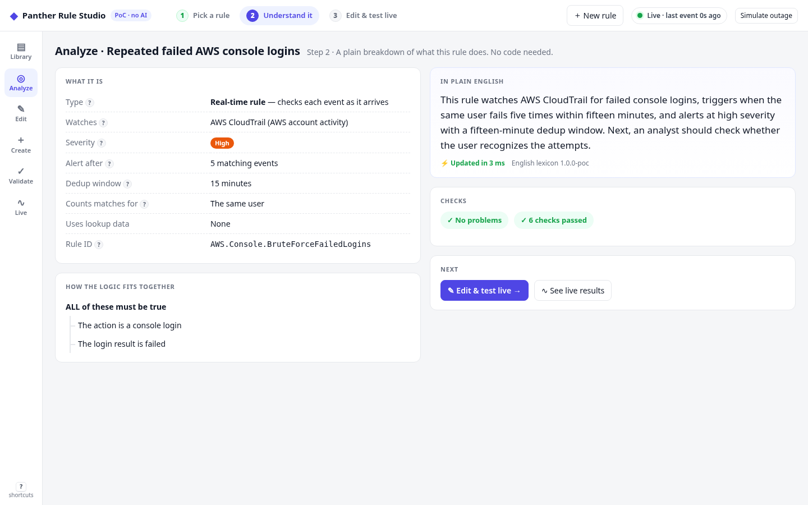
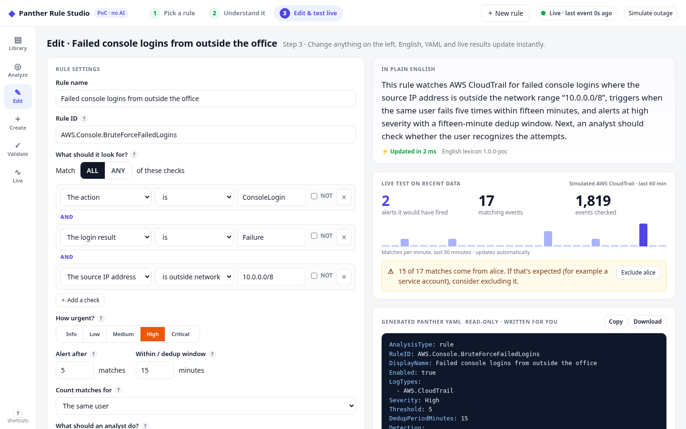

# Panther Rule Studio

Panther detections are hard to read, harder to review, and too easy to ship untested. A real-time rule is usually Python plus a YAML spec. A Simple Detection is a YAML `Detection:` block. A scheduled query is SQL, often paired with a scheduled rule. That mix is a lot to hold in your head when you are not a full-time Python developer — and it is easy to miss what will actually page a SOC analyst.

**Panther Rule Studio** is a form-driven studio for Panther detections. It helps you write, read, and test rules in the browser, with live plain-English explanations of what a detection catches, when it fires, and what happens next. No LLM. Nothing leaves your machine.

> Independent community project; not affiliated with or endorsed by Panther Labs.

## What it does

The [architecture specification (v1.2)](docs/Panther_Rule_Studio_Architecture.md) describes a Panther-native workflow:

- **Parses Panther Python rules, YAML rule specs, and scheduled queries** into a structured model. Python bodies are read with an AST and never executed. YAML Simple Detections and SQL scheduled queries are parsed the same way, so you can inspect a detection without spelunking through code.
- **Form-driven creation of Panther rules**, generating valid Panther YAML behind the scenes — Simple Detection YAML for real-time rules that fit the form, or the matching YAML (and Python, where needed) for other types.
- **Logic-tree explanations in plain English** that update as you edit: what the rule watches, when it triggers, and the runbook next step.
- **Static validation** against Panther conventions (for example RuleID, severity levels, and whether `Tests` are present) before a detection would be uploaded.
- **Designed to sit beside PAT and a `panther-analysis` repo**, not replace them. The tool produces Panther files you can drop into your existing detections workflow. Optional `pat test` / `pat validate` is specified as an admin opt-in in a locked-down container. It does not upload to Panther or replace the Panther Console.

### What the PoC implements today

The runnable proof of concept in `poc/` is a local, beginner-friendly slice of that design:

- A bundled sample library of Panther-style real-time rules
- A five-step wizard and form editor that build **Panther Simple Detection YAML** (`AnalysisType: rule` with a `Detection:` block)
- Live plain-English explanations and generated YAML on every edit
- Static validation with one-click fixes
- Live analysis on a **simulated CloudTrail** stream: would-have-fired counts, matches, and false-positive hints
- No frameworks, no CDN, no AI, no login, and no Panther API connection — Python 3.10+ standard library and plain JavaScript, bound to `127.0.0.1`

The PoC does **not** yet parse Python or SQL source files, run `pat test` / `pat validate`, load a `panther-analysis` checkout, generate Panther `Tests:` blocks, or connect to a live Panther instance. Scheduled queries and policies appear in the wizard but are marked as coming next. The form editor covers a Simple Detection subset (ALL/ANY groups; equals, not equals, contains, starts with, one of, in network range).

## See it





## 60-second quickstart

You need Python 3.10 or later. No packages to install.

```bash
cd poc
python3 server.py
```

Then open http://127.0.0.1:8765

1. Pick a rule in the library — it opens instantly.
2. Read it in Analyze: the breakdown, the logic tree in plain words, and the checks.
3. Edit it in the form. English and YAML update in milliseconds, and the live test reruns on its own.

Demo URLs once the server is up: `/#/create/1` through `/#/create/5`, `/?demo=edit#/edit`, `/?demo=error#/validate`, `/?outage=1#/live`.

Shortcuts: `/` search, `↑ ↓` move, `Enter` open, `L A E V G` switch views, `N` new rule, `?` help.

## Who it's for

- **SOC analysts** who need to understand what a Panther detection actually does before they trust the alert
- **Panther detection engineers** who want to draft and validate Simple Detections without bouncing between a text editor, PAT, and the Console
- **Reviewers** who are signing off on changes in a detections repo and want a readable explanation, not just a YAML or Python diff

If you can fill out a form, you can work a real-time Panther rule in the PoC.

## Architecture in brief

The PoC is a local web app: a Python standard-library server and a dependency-free UI. A rule is held as a form, rendered as plain English, emitted as Panther Simple Detection YAML, validated statically, and evaluated against a simulated event stream pushed to the browser over SSE. User code is never executed. There is no cloud backend, no model, and no connection to your Panther instance.

The full design — parsers for Python, YAML and SQL, the intermediate representation, the renderer, validation (including Panther `Tests`), optional PAT integration, a local `panther-analysis` library, live analysis, and the security model — is in the [architecture specification (v1.2)](docs/Panther_Rule_Studio_Architecture.md). A Word copy with embedded screenshots is in [`docs/Panther_Rule_Studio_Architecture.docx`](docs/Panther_Rule_Studio_Architecture.docx).

### Repository layout

```
poc/                 Proof-of-concept app (server, UI, and styles)
docs/                Architecture specification (Markdown and Word)
docs/screens/        Interface screenshots
```

## Roadmap

The PoC covers the library, Analyze, a five-step Create wizard, the form editor with live English and YAML, Validate, and Live analysis on simulated data.

Next up, as specified:

- Parsers and Analyze views for Panther Python detections and SQL scheduled queries, then broader form support for those types
- Optional loading of a local `panther-analysis` checkout as the rule library
- Optional `pat test` / `pat validate` in a locked-down container, and generated YAML that includes Panther `Tests`
- A read-only Panther data-lake adapter, after replay of sanitized samples
- Correlation-rule support and a coverage map (for example MITRE ATT&CK from `Reports`)
- Git integration so generated files can go out as a pull request to your detections repo
- Hardening for a team deployment (SSO at the proxy, audit logging, container packaging)

A later, optional v2 may add AI assistance (rephrasing explanations, suggested tuning, natural-language drafts). That stays off by default: the deterministic English remains the source of truth, and no rule content leaves your environment without an explicit admin choice.

## Contributing

Issues and pull requests are welcome.

- Keep v1 deterministic: no LLM calls, no "best guess" explanations.
- Don't add cloud services, CDNs, or telemetry. The app should keep running fully offline.
- Never commit secrets, Panther API tokens, or real event data. The PoC uses simulated events only.
- Match the existing style: Python standard library on the server, plain JavaScript in the UI.
- Do not claim a Panther Console, PAT, or data-lake integration until it actually exists.

## Author

Timothy English, CISSP, CEH, CHFI, Cybersecurity Researcher

Independent community project; not affiliated with or endorsed by Panther Labs.
