# Panther Rule Studio — Architecture Specification

**Author: Timothy English, CISSP, CEH, CHFI, Cybersecurity Researcher**

| | |
|---|---|
| **Document** | Panther Rule Studio (PRS) — Architecture Specification |
| **Version** | 1.2 (adds the working proof of concept, live analysis, step-by-step screenshots and performance targets) |
| **Author** | Timothy English, CISSP, CEH, CHFI, Cybersecurity Researcher |
| **Status** | Draft for review |
| **Date** | November 20, 2026 |
| **Scope** | v1: deterministic, form-driven, **no LLM/AI anywhere**. v1 PoC: live analysis against a simulated or real-time event stream. |

---

## Table of Contents

1. [Purpose and Audience](#1-purpose-and-audience)
2. [Panther in Five Minutes (Primer for Beginners)](#2-panther-in-five-minutes-primer-for-beginners)
3. [Requirements and Traceability](#3-requirements-and-traceability)
4. [Architecture Overview](#4-architecture-overview)
5. [Technology Stack (Minimal Dependencies)](#5-technology-stack-minimal-dependencies)
6. [Component Specifications](#6-component-specifications)
7. [Intermediate Representation (IR) Data Model](#7-intermediate-representation-ir-data-model)
8. [Parsing (Deterministic Extraction)](#8-parsing-deterministic-extraction)
9. [Validation](#9-validation)
10. [Rule Generation](#10-rule-generation)
11. [Plain-English Renderer (Key Feature)](#11-plain-english-renderer-key-feature)
12. [Phrase Lexicon Versioning](#12-phrase-lexicon-versioning)
13. [SDLC and Test Strategy](#13-sdlc-and-test-strategy)
14. [Live Analysis Engine (Real-Time, On the Fly)](#14-live-analysis-engine-real-time-on-the-fly)
15. [State Management and Responsiveness](#15-state-management-and-responsiveness)
16. [Real-Time Push: SSE vs WebSockets](#16-real-time-push-sse-vs-websockets)
17. [Graceful Degradation](#17-graceful-degradation)
18. [End-to-End Data Flow](#18-end-to-end-data-flow)
19. [Communication Path, Protocols and Trust Boundaries](#19-communication-path-protocols-and-trust-boundaries)
20. [API Keys, Secrets and Application Authentication](#20-api-keys-secrets-and-application-authentication)
21. [Interface Design and Working PoC Screens](#21-interface-design-and-working-poc-screens)
22. [Performance](#22-performance)
23. [Module and Directory Layout](#23-module-and-directory-layout)
24. [Error Handling](#24-error-handling)
25. [Deployment Options](#25-deployment-options)
26. [PoC Scope and Milestones](#26-poc-scope-and-milestones)
27. [v2 Roadmap (Where AI Could Go)](#27-v2-roadmap-where-ai-could-go)
28. [Appendices](#28-appendices)

---

## 1. Purpose and Audience

**Panther Rule Studio (PRS)** is a web-based tool that helps **new and beginner security analysts** analyze, validate, write and generate detections for the **Panther SIEM**. Someone with **zero Panther knowledge** should be able to:

- Paste or pick an existing Panther detection and understand, in plain English, what it catches, when it fires and what happens next.
- Build a new detection by filling in a guided form, without touching YAML, Python or SQL.
- Know whether a detection is valid before it ever reaches Panther.
- See, **live**, how a detection behaves against recent real-time data: how often it would fire, what it matched, and whether it looks noisy.

### Design principles

1. **Deterministic, no AI in v1.** Every output is reproducible from the input and the versioned lexicon. No LLM calls, no model weights, no "best guess".
2. **Never execute user code.** Python detections are parsed with `ast`. They are never imported, `exec`'d or `eval`'d.
3. **Beginner-first.** No raw code in the explanation views. Every Panther term has a tooltip and a glossary entry.
4. **Minimal dependencies.** A small, auditable dependency tree that a security team can review in an afternoon.
5. **Secrets stay server-side.** The browser never sees a Panther API token.
6. **Honest output.** If the tool can't explain or evaluate part of a rule, it says so plainly instead of guessing.

### Non-goals for v1

- Any LLM, AI-assisted writing or AI-generated explanations (see the [v2 roadmap](#27-v2-roadmap-where-ai-could-go)).
- Uploading or deploying detections to production Panther. PRS produces files; deployment stays in the team's existing PAT/CI workflow.
- Replacing the Panther Console or Panther Analysis Tool (PAT).

---

## 2. Panther in Five Minutes (Primer for Beginners)

This primer is also shipped inside the app as the **Glossary** and as tooltips.

| Term | Plain-English meaning |
|---|---|
| **Detection** | Any piece of logic that watches data and raises an alert when something suspicious happens. |
| **Rule** (`AnalysisType: rule`) | A detection that looks at each log event **as it streams in** (real time). |
| **Scheduled query** (`AnalysisType: scheduled_query`) | A saved SQL search that Panther runs on a timer over the data lake. |
| **Scheduled rule** (`AnalysisType: scheduled_rule`) | A detection that runs on the **results of a scheduled query** and alerts on them. It's linked to queries through `ScheduledQueries`. |
| **Policy** (`AnalysisType: policy`) | A detection that checks the **configuration of a cloud resource** (for example, "is this S3 bucket public?") rather than log events. |
| **Simple Detection** | A rule written entirely in YAML using a `Detection:` block of match expressions instead of Python. |
| **Log type** (`LogTypes`) | The kind of data the rule watches, such as `AWS.CloudTrail` or `Okta.SystemLog`. |
| **Severity** | How urgent the alert is: Info, Low, Medium, High or Critical. |
| **Threshold** | How many matching events must happen before an alert fires (default 1). |
| **Dedup period** (`DedupPeriodMinutes`) | The time window during which repeat matches are grouped into one alert instead of many (default 60 minutes). |
| **Dedup key** | What "the same thing" means when grouping, such as the same user or the same IP. Set by a Python `dedup()` function or `GroupBy` in a Simple Detection. Without one, Panther groups by the alert title. |
| **Lookup table / enrichment** | Reference data (such as a list of known VPN IPs) that Panther attaches to events under `p_enrichment`, so rules can use it. |
| **Data lake** | Where Panther stores all normalized logs. You search it with SQL. |
| **PAT** | Panther Analysis Tool, the command-line tool teams use to test and upload detections. |

---

## 3. Requirements and Traceability

| ID | Requirement (from Tim) | Where addressed |
|---|---|---|
| F1 | Ingest a detection as raw text: YAML, inline Python or SQL; accept any format | §6.1, §8 |
| F2 | Deterministic (non-LLM) extraction of rule type, query logic, thresholds, dedup keys, enrichment/reference dependencies | §7, §8 |
| F3 | Form-driven rule creation (scheduled query, real-time rule, policy); generate valid Panther YAML behind the scenes | §10, §21.4 |
| F4 | Validation against Panther's spec: required fields, syntax, dedup window sanity | §9 |
| F5 | Analysis mode: structured breakdown of an existing rule | §21.3 |
| F6 | Plain-English renderer using a logic tree, dynamic composition, no code in output | §11 |
| F7 | Renderer as its own module, exhaustive Boolean unit tests, lexicon versioned separately | §12, §13 |
| UI | Modern, minimal dependencies, not clunky; mockups; beginner-friendly | §21 |
| SEC | API keys and secrets on the communication path | §20 |
| COMM | Complete end-to-end communication path | §19 |
| STEPS | Interface examples of the web interface for each step | §21.0 (12 real screenshots) |
| PERF | Easy-to-use UI, very fast | §21, §22 |
| P1 | **PoC: rule selection** — browse and select existing rules; instant detail view | §21.2, §26 |
| P2 | **PoC: rule editing** — form-only editor; plain English **and** YAML update live | §15, §21.4, §26 |
| P3 | **PoC: transparent live analysis** — background evaluation against a real-time or simulated stream; matches, alerts and false-positive indicators appear automatically | §14–§17, §21.5, §26 |

---

## 4. Architecture Overview

PRS is a classic three-tier web app with a deterministic core library and an optional live-data layer.

```
┌──────────────────────────────────────────────────────────────────────────┐
│ PRESENTATION (browser)                                                   │
│  Library · Analyze · Create/Edit wizard · Validate · Plain English ·     │
│  Live Analysis panel · Glossary                                          │
│  Vanilla JS (ES modules) + tiny reactive store · optional Preact/HTMX    │
└───────────────▲───────────────────────────────┬──────────────────────────┘
                │ SSE (live push)                │ HTTPS JSON (REST)
┌───────────────┴───────────────────────────────▼──────────────────────────┐
│ APPLICATION (FastAPI / ASGI)                                             │
│  API routes · session state · auth · rate limiting · redaction           │
│  Live Analysis Orchestrator (asyncio tasks, per-session, latest-wins)    │
└───────┬──────────────────────────┬───────────────────────────┬───────────┘
        │ in-process calls         │                           │
┌───────▼──────────────────────────▼───────┐   ┌───────────────▼───────────┐
│ CORE (pure Python, no I/O)               │   │ DATA SOURCES (adapters)   │
│  ingest/detect → parsers → normalizer→IR │   │  SimulatedStream (PoC)    │
│  validator · generator · logic tree ·    │   │  ReplayFile               │
│  renderer + versioned lexicon ·          │   │  PantherDataLakePoller    │
│  evaluator (IR-only, safe)               │   │  PantherAlertsPoller      │
└──────────────────────────────────────────┘   │  WebhookReceiver (opt.)   │
                                               └───────────────┬───────────┘
                                                               │ HTTPS 443, X-API-Key
                                               ┌───────────────▼───────────┐
                                               │ Panther (optional)        │
                                               │  GraphQL /public/graphql  │
                                               │  REST /rules, /alerts ... │
                                               └───────────────────────────┘
```

**Key architectural decisions**

| Decision | Choice | Why |
|---|---|---|
| Core as a pure library | `prs_core` has no network, no disk, no globals | Easy to unit test, reusable from a CLI or CI, and safe to run on untrusted input |
| One canonical IR | Every format normalizes into one IR (§7) | The validator, generator, renderer and evaluator are written once |
| Renderer isolated | `prs_core.render` depends only on the IR and the lexicon | Meets F7; lexicon changes never touch parsing |
| Evaluate the IR, not the code | Live analysis runs a safe interpreter over IR condition trees | No user code ever executes on the server |
| Pluggable data sources | `DataSource` protocol (§14.3) | PoC uses simulated data; production swaps in Panther without UI changes |
| Server-push via SSE | One-way stream over plain HTTP | Simplest real-time push; no extra dependency (§16) |

---

## 5. Technology Stack (Minimal Dependencies)

### Backend (Python 3.12+)

| Package | Purpose | Why this one |
|---|---|---|
| **FastAPI** + **uvicorn** | HTTP API, SSE streaming, request validation | Async-native (needed for background analysis), typed, small surface. *Stdlib-light alternative:* Starlette alone, or `http.server` for the PoC skeleton. |
| **pydantic** (comes with FastAPI) | IR models and API schemas | Single source of truth for the IR; JSON Schema export for free |
| **PyYAML** (`yaml.safe_load` only) | Parse and emit Panther YAML | De facto standard; `safe_load` blocks object construction attacks |
| **sqlglot** | Parse scheduled-query SQL (Snowflake dialect) into an AST | Pure Python, no native deps, understands Snowflake, which most Panther data lakes use |
| **httpx** | Outbound HTTPS to Panther | Async, timeouts and TLS verification by default |
| `ast` (stdlib) | Parse Python detections | Never executes code |
| `asyncio`, `collections.deque`, `logging`, `hashlib`, `hmac` (stdlib) | Background tasks, ring buffers, logs, webhook signatures | No dependency cost |

**Dev/test only:** `pytest`, `hypothesis` (property-based tests), `ruff`, `mypy`, `pip-audit`.

**Explicitly excluded:** ORMs, Celery/Redis (not needed at PoC scale; see §15.3), any ML/LLM library, any template engine for English output.

### Frontend

| Option | Recommendation |
|---|---|
| **Vanilla JS ES modules + a ~60-line reactive store + native `EventSource`** | **Recommended for v1.** Zero build step, zero npm dependencies, served as static files. |
| Preact + `htm` (≈4 KB, no build) | Use if component count grows past ~15 views. |
| HTMX + SSE extension | Good if the team prefers server-rendered HTML fragments. |

Styling: one hand-written CSS file using CSS variables (light/dark), system font stack, CSS Grid. No CSS framework.

### Storage

- **PoC:** in-memory per session, plus a read-only rule library loaded from a folder of YAML/Python files (for example a clone of `panther-labs/panther-analysis`).
- **Production:** SQLite (stdlib `sqlite3`) for saved drafts and audit log; optional Postgres if multi-instance.

---

## 6. Component Specifications

### 6.1 Ingestion and Format Detector (`prs_core.ingest`)

Accepts raw text (paste, file upload up to 512 KB, or a library pick). It may receive one file or a bundle (a `.yml` plus its `.py`, or a `.yml` that embeds a query).

Detection order (deterministic, first match wins):

1. Parses as YAML **and** has an `AnalysisType` key → **Panther YAML spec**. If `Filename` points to a `.py` that was supplied in the bundle, attach it.
2. Parses with `ast.parse` **and** defines `def rule(event)` or `def policy(resource)` → **Python detection body**. Ask the user (via a form field) for the missing metadata, or infer defaults.
3. `sqlglot.parse_one(dialect="snowflake")` succeeds with a `SELECT` → **SQL scheduled query**.
4. Otherwise → `UNRECOGNIZED_FORMAT` error with beginner guidance ("This doesn't look like a Panther rule. Panther rules are usually YAML files that start with `AnalysisType:`").

### 6.2 Parsers (`prs_core.parse.yaml_spec`, `.python_body`, `.sql_query`)

Each parser outputs a **format-specific parse result**, which the normalizer converts to the IR. Details are in §8.

### 6.3 Normalizer (`prs_core.normalize`)

Merges metadata and logic into a single `DetectionIR`, applies Panther defaults (`Threshold: 1`, `DedupPeriodMinutes: 60`), canonicalizes the condition tree (flatten nested same-operator groups, push NOT down where safe, sort nothing — order is preserved for readability), and records **source spans** so the UI can highlight where a fact came from.

### 6.4 Validator (`prs_core.validate`)

Runs ordered rule checks against the IR and the raw spec. It produces `Finding` objects (`error` / `warning` / `info`) with a code, plain-English message, fix suggestion and source span. It can optionally call Panther for live validation (§9.3).

### 6.5 Generator (`prs_core.generate`)

Turns an IR built from the form into Panther files: a Simple Detection YAML, or YAML plus a Python file, or a scheduled query YAML plus a scheduled rule YAML. Output is deterministic (stable key order, stable formatting) so diffs are clean.

### 6.6 Logic Tree Builder and Renderer (`prs_core.render`)

Builds a Boolean logic tree from the IR and walks it to compose English using the versioned lexicon (§11, §12).

### 6.7 Evaluator (`prs_core.evaluate`)

A small, safe interpreter that evaluates an IR condition tree against a JSON event (dict). It supports the same operators as the IR. It has no `eval`, no attribute access and no imports. It also simulates threshold and dedup grouping to compute "would have fired N alerts".

### 6.8 Live Analysis Orchestrator (`prs_app.live`)

Per-session background task that owns the event window, re-evaluates the current draft when it changes or new events arrive, and pushes results over SSE (§14, §15).

### 6.9 Data Source Adapters (`prs_app.sources`)

Implementations of the `DataSource` protocol: simulated stream, replay file, Panther data lake poller, Panther alerts poller, and optional webhook receiver (§14.2–§14.3).

### 6.10 Rule Library (`prs_app.library`)

Indexes a local folder of detections (for example `panther-analysis`) at startup into a lightweight catalog (ID, display name, log types, severity, type, tags, file paths). With a Panther connection, it can also list rules from Panther's REST API (`GET /rules`, `GET /simple-rules`, `GET /policies`, `GET /queries`; requires **View Rules** / **View Policies**).

### 6.11 Panther Client (`prs_app.panther`)

The only module allowed to talk to Panther. It holds the token, injects the `X-API-Key` header, applies timeouts, retries and backoff, and redacts logs (§20).

---

## 7. Intermediate Representation (IR) Data Model

All formats normalize into `DetectionIR`. It is defined as pydantic models; JSON Schema is exported to `schemas/ir.v1.json` and versioned as `ir_version`.

```python
# prs_core/ir.py  (abridged)
from typing import Literal, Union
from pydantic import BaseModel, Field

Severity = Literal["Info", "Low", "Medium", "High", "Critical"]
DetectionKind = Literal["rule", "scheduled_rule", "scheduled_query", "policy"]
Authoring = Literal["simple_yaml", "python", "sql"]

class FieldRef(BaseModel):
    path: list[str]                 # ["responseElements", "ConsoleLogin"]
    source: Literal["event", "enrichment", "resource", "query_column"] = "event"
    enrichment_table: str | None = None   # lookup table name, if source == "enrichment"

class Condition(BaseModel):         # leaf node
    kind: Literal["condition"] = "condition"
    field: FieldRef
    op: Literal[
        "equals", "not_equals", "contains", "not_contains",
        "starts_with", "ends_with", "in", "not_in",
        "gt", "gte", "lt", "lte",
        "exists", "not_exists", "is_null_or_empty", "not_null_or_empty",
        "in_cidr", "not_in_cidr", "is_public_ip", "is_private_ip",
        "any_element", "all_elements",
    ]
    value: str | int | float | bool | list | None = None
    case_insensitive: bool = False
    span: tuple[int, int] | None = None   # source offsets for UI highlight

class Group(BaseModel):              # internal node
    kind: Literal["group"] = "group"
    op: Literal["all", "any", "only_one", "none"]    # AND, OR, XOR-ish, NOR
    children: list["Node"]

class Not(BaseModel):
    kind: Literal["not"] = "not"
    child: "Node"

class Opaque(BaseModel):             # logic PRS cannot translate (honest fallback)
    kind: Literal["opaque"] = "opaque"
    reason: str                      # "calls helper is_ip_in_network()"
    snippet_hash: str                # never the code itself in English output

Node = Union[Condition, Group, Not, Opaque]

class Dedup(BaseModel):
    period_minutes: int = 60
    keys: list[FieldRef] = []        # from dedup() or GroupBy
    keys_from_title: bool = False    # Panther falls back to the title when no dedup key

class Schedule(BaseModel):
    cron: str | None = None
    rate_minutes: int | None = None
    timeout_minutes: int | None = None

class QueryLogic(BaseModel):         # for scheduled queries
    tables: list[str]                # "panther_logs.public.aws_cloudtrail"
    where: Node | None
    group_by: list[str] = []
    having_count_gte: int | None = None
    lookback_hint_minutes: int | None = None   # from p_event_time filters

class DetectionIR(BaseModel):
    ir_version: Literal["1"] = "1"
    kind: DetectionKind
    authoring: Authoring
    id: str                          # RuleID / PolicyID / QueryName
    display_name: str | None = None
    enabled: bool = True
    log_types: list[str] = []        # rules
    resource_types: list[str] = []   # policies
    severity: Severity = "Medium"
    dynamic_severity: bool = False
    threshold: int = 1
    dedup: Dedup = Dedup()
    logic: Node | None = None        # rule/policy match logic
    inline_filters: Node | None = None
    query: QueryLogic | None = None
    scheduled_queries: list[str] = []    # scheduled_rule → query names
    schedule: Schedule | None = None
    enrichments: list[str] = []      # lookup tables referenced
    helpers: list[str] = []          # imported global helpers
    alert_title: str | None = None   # literal or "dynamic"
    runbook: str | None = None
    reference: str | None = None
    tags: list[str] = []
    reports: dict[str, list[str]] = {}
    tests: list[dict] = []
    warnings: list[str] = []         # parse-time notes
```

---

## 8. Parsing (Deterministic Extraction)

### 8.1 YAML specs

- `yaml.safe_load` only. Reject documents larger than 512 KB, YAML anchors deeper than 20 levels, and duplicate keys (custom loader) to avoid ambiguity.
- Map metadata keys 1:1: `AnalysisType`, `RuleID` / `PolicyID` / `QueryName`, `DisplayName`, `Enabled`, `LogTypes`, `ResourceTypes`, `Severity`, `Threshold`, `DedupPeriodMinutes`, `Filename`, `Detection`, `InlineFilters`, `GroupBy`, `DynamicSeverities`, `AlertTitle`, `AlertContext`, `ScheduledQueries`, `Query` / `SnowflakeQuery` / `AthenaQuery`, `Schedule` (`CronExpression` or `RateMinutes`, `TimeoutMinutes`), `Description`, `Runbook`, `Reference`, `Tags`, `Reports`, `Tests`, `OutputIds`, `SummaryAttributes`, `CreateAlert`.
- **Simple Detection `Detection:` block → IR tree**:
  - A top-level list is an implicit **All** (AND).
  - Combinators `All`, `Any`, `OnlyOne`, `None` → `Group(op=all|any|only_one|none)`.
  - Key specifiers `Key`, `KeyPath` (dotted), `DeepKey` (list) → `FieldRef.path`.
  - `Condition` names map to IR ops (for example `Equals → equals`, `DoesNotEqual → not_equals`, `IsIn → in`, `IsIPAddressInCIDR → in_cidr`, the `I…` case-insensitive variants set `case_insensitive=True`).
  - List comprehension (`AnyElement`, `AllElements`, `OnlyOneElement`) → `any_element` / `all_elements` with a nested tree.
  - `Enrichment` (`Table`, `Selector`, `FieldPath`) → `FieldRef(source="enrichment", enrichment_table=Table)` and adds the table to `enrichments`.
  - The mapping table lives in `prs_core/parse/simple_ops.py` and is checked against a fixture set of real `panther-analysis` Simple Detections in CI.

### 8.2 Python bodies (AST, never executed)

`ast.parse(source)` and a `NodeVisitor`:

| Python pattern | Extracted as |
|---|---|
| `def rule(event):` / `def policy(resource):` | Detection kind and the root expression to translate |
| `return <expr>` in `rule()` | Logic tree root |
| Early `if <cond>: return False` | `All(Not(cond), rest)` |
| `and` / `or` / `not` (`BoolOp`, `UnaryOp`) | `Group(all)` / `Group(any)` / `Not` |
| `event.get("a") == "x"`, `event["a"] == "x"` | `Condition(path=["a"], op=equals, value="x")` |
| `event.deep_get("a","b")`, `deep_get(event,"a","b")`, `event.deep_walk(...)` | `FieldRef(path=["a","b"])` |
| `x in ("a","b")`, `x not in {...}` | `in` / `not_in` |
| `.startswith()`, `.endswith()`, `"s" in x` | `starts_with`, `ends_with`, `contains` |
| `<`, `<=`, `>`, `>=` | `lt`, `lte`, `gt`, `gte` |
| Module-level constants (`SUSPICIOUS = {...}`) | Resolved by constant folding, literals only |
| `event.deep_get("p_enrichment", "<table>", ...)` | Enrichment dependency |
| `def dedup(event): return event.deep_get("userIdentity","arn")` | `Dedup.keys` |
| `def title(event)` | `alert_title = "dynamic"`; literal parts kept for the explanation |
| `def severity(event)` | `dynamic_severity = True` |
| `import` / `from panther_base_helpers import …` | `helpers` list |
| Anything else (function calls to helpers, loops, try/except) | `Opaque(reason=…)` node; rendered honestly (§11.6) |

Safety: the visitor has a node budget (50,000 nodes) and a recursion limit to defend against pathological input. The source is never compiled to bytecode beyond `ast.parse`.

### 8.3 SQL scheduled queries (sqlglot)

- `sqlglot.parse_one(sql, dialect="snowflake")`, with Athena as a fallback dialect for legacy `AthenaQuery`.
- `FROM` tables → `QueryLogic.tables`; `panther_logs.public.aws_cloudtrail` is mapped to the log type `AWS.CloudTrail` via a table→log-type map.
- `WHERE` → IR tree (`AND`/`OR`/`NOT`, `=`, `!=`, `IN`, `LIKE 'x%'` → `starts_with`, `ILIKE` → `case_insensitive`, `IS NULL`, comparisons).
- `p_occurs_since('1 hour')` macro or `p_event_time >= DATEADD(...)` → `lookback_hint_minutes`.
- `GROUP BY` → grouping keys (rendered as "for the same user …").
- `HAVING COUNT(*) >= N` → `having_count_gte`, rendered like a threshold.
- Joins, CTEs and window functions are summarized at a higher level ("combines CloudTrail with Okta data") and flagged as partially explained.

### 8.4 Extraction summary (what Analyze mode shows)

Rule type, log sources, match logic tree, threshold, dedup window and keys, severity (static or dynamic), schedule, linked queries, enrichment tables, helpers used, tests present (count of positive/negative), and any opaque sections.

---

## 9. Validation

### 9.1 Static checks (offline, always on)

| Code | Severity | Check |
|---|---|---|
| V001 | error | YAML or Python or SQL syntax error (with line and column) |
| V002 | error | `AnalysisType` missing or not one of `rule`, `scheduled_rule`, `scheduled_query`, `policy` (also `correlation_rule`, `datamodel`, `global`, `lookup_table`, `saved_query` recognized but out of scope for editing) |
| V003 | error | Required keys missing — rule: `AnalysisType`, `Enabled`, `RuleID`, `LogTypes`, `Severity`, and either `Filename` (Python) or `Detection` (Simple); scheduled_rule: `ScheduledQueries` instead of `LogTypes`; policy: `PolicyID`, `ResourceTypes`, `Filename`; scheduled_query: `QueryName`, a query body, `Schedule` |
| V004 | error | `Severity` not in Info/Low/Medium/High/Critical |
| V005 | error | `Threshold` or `DedupPeriodMinutes` not a positive integer (Panther's API minimum is 1) |
| V006 | warning | Dedup window sanity: dedup shorter than 5 minutes (alert flood risk) or longer than 1440 minutes / 24 hours (will hide new incidents). Tool policy, configurable. |
| V007 | warning | `Threshold` > 1 with no dedup key: unrelated events will be counted together toward the threshold |
| V008 | warning | Scheduled rule whose dedup window is shorter than its query's schedule interval (alerts can't be grouped as the author likely expects) |
| V009 | error | Python file missing `rule()` / `policy()`, or `Filename` doesn't match a supplied file |
| V010 | error | `Detection` block uses an unknown `Condition` or combinator, or mixes `Value`/`Values` incorrectly |
| V011 | warning | Unknown `LogTypes` value (checked against a bundled list, or the live list from Panther when connected) |
| V012 | warning | No `Tests`, or no negative (false) test case |
| V013 | warning | Referenced lookup table not known (live mode) |
| V014 | info | Rule disabled (`Enabled: false`) |
| V015 | warning | Logic is always true / always false (detected by the evaluator on a truth-table of leaves, up to 12 leaves) |
| V016 | warning | `RuleID` doesn't follow `Vendor.Service.Behavior` naming convention |
| V017 | error | Scheduled query has neither `CronExpression` nor `RateMinutes` |

Each finding is shown in plain English with a "How to fix" line and, where possible, a one-click form fix.

### 9.2 Local test execution (optional, off by default)

PRS **does not** run user Python. For teams that want test execution, PRS can shell out to `pat test` **inside a locked-down container** (no network, read-only filesystem, CPU/memory/time limits). This is an admin opt-in.

### 9.3 Live validation against Panther (optional)

- `pat validate --path <tmpdir> --api-host https://api.<instance>.runpanther.net/public/graphql` runs the same checks Panther runs at upload time. The token needs **`BulkUploadValidate`** (Bulk Upload Validate) only. The token is passed via environment variable, never on the command line (to keep it out of `ps` output).
- For Python rules, Panther's REST API supports `POST /rules?run-tests-only=true` (run tests without saving), but it requires **Manage Rules**, a write permission. PRS treats this as **disabled by default**; enable only with a dedicated, IP-restricted token in a non-production Panther instance.

---

## 10. Rule Generation

The Create/Edit wizard writes into a form model, which is converted to IR, validated, then emitted.

| Analyst choice | PRS output |
|---|---|
| Real-time rule, all conditions expressible in the form | **Simple Detection YAML** (`AnalysisType: rule` + `Detection:`), preferred for beginners because Panther's Console can open it in the Simple Detection builder |
| Real-time rule needing Python (opt-in "advanced output") | `rule.yml` with `Filename:` + generated `rule.py` with `rule()`, `title()`, `dedup()` written from the IR |
| Scheduled query | `query.yml` (`AnalysisType: scheduled_query`, `QueryName`, `Query`, `Schedule`) + `scheduled_rule.yml` (`AnalysisType: scheduled_rule`, `ScheduledQueries: [QueryName]`) + `.py` |
| Policy | `policy.yml` (`AnalysisType: policy`, `PolicyID`, `ResourceTypes`) + `policy.py` with `policy(resource)` |

Generated tests: the wizard asks for one "should alert" and one "should not alert" sample event (prefilled from the live stream when available) and writes them into `Tests:` with `ExpectedResult: true/false`.

Example generated Simple Detection:

```yaml
AnalysisType: rule
RuleID: AWS.Console.BruteForceFailedLogins
DisplayName: Repeated failed AWS console logins
Enabled: true
LogTypes:
  - AWS.CloudTrail
Severity: High
Threshold: 5
DedupPeriodMinutes: 15
Detection:
  - Key: eventName
    Condition: Equals
    Value: ConsoleLogin
  - KeyPath: responseElements.ConsoleLogin
    Condition: Equals
    Value: Failure
GroupBy:
  - KeyPath: userIdentity.arn
AlertTitle: "Repeated failed console logins for {userIdentity.arn}"
Runbook: >
  Check whether the user recognizes the attempts. If not, reset the password and review source IPs.
Tests:
  - Name: Failed console login
    ExpectedResult: true
    Log: {"eventName": "ConsoleLogin", "responseElements": {"ConsoleLogin": "Failure"}, "userIdentity": {"arn": "arn:aws:iam::123456789012:user/alice"}}
  - Name: Successful console login
    ExpectedResult: false
    Log: {"eventName": "ConsoleLogin", "responseElements": {"ConsoleLogin": "Success"}, "userIdentity": {"arn": "arn:aws:iam::123456789012:user/alice"}}
```

> Note on `Threshold`: Panther counts matching events toward the threshold per dedup group within the dedup window, so "5 failures within 15 minutes for the same user" is expressed as `Threshold: 5`, `DedupPeriodMinutes: 15`, `GroupBy: userIdentity.arn`.

---

## 11. Plain-English Renderer (Key Feature)

### 11.1 Goals

- Every loaded or generated rule gets a short explanation covering **what it catches**, **when it fires** and **what happens next**.
- **No YAML, code, field paths or SQL** in the output (enforced by tests, §13).
- **Dynamic composition**: sentences are built by walking a logic tree; there are no per-rule templates.
- Deterministic: same IR + same lexicon version → byte-identical output.

### 11.2 Output structure (sentence plan)

```
[WATCH]    This rule watches {source phrase} for {primary activity}
[LOGIC]    … {logic phrase built from the tree}
[TRIGGER]  , triggers when {threshold phrase} {grouping phrase} within {window}
[SEVERITY] , and alerts at {severity} severity
[DEDUP]    with a {dedup window} dedup window.
[NEXT]     Next: {runbook summary | default next step for severity}.
[CAVEATS]  {honest notes about parts it couldn't explain}
```

Example (from the IR in §10):

> This rule watches AWS CloudTrail for failed console logins, triggers when the same user fails five times within fifteen minutes, and alerts at high severity with a fifteen-minute dedup window. Next, an analyst should check whether the user recognizes the attempts.

### 11.3 Logic tree

Built from `DetectionIR.logic` (and `inline_filters` and `query.where` combined as an AND at the root).

```
            ALL
          /     \
   [eventName =    [responseElements.ConsoleLogin =
    ConsoleLogin]    Failure]
```

Nodes are `Condition` leaves; edges/inner nodes are `ALL` (AND), `ANY` (OR), `NONE` (NOR) and `ONLY_ONE`, plus `NOT`.

### 11.4 Walk algorithm

```python
def phrase(node, ctx, lex) -> Phrase:
    match node:
        case Condition():
            return leaf_phrase(node, ctx, lex)            # §11.5
        case Not(child=c):
            return negate(phrase(c, ctx, lex), lex)       # §11.6
        case Group(op="all", children=cs):
            parts = [phrase(c, ctx.deeper(), lex) for c in cs]
            parts = merge_same_subject(parts, lex)        # "is X and is Y" → "is X and Y"
            return join(parts, lex.conj["and"], ctx)      # Oxford comma, §11.7
        case Group(op="any", children=cs):
            parts = [phrase(c, ctx.deeper(), lex) for c in cs]
            parts = collapse_in_list(parts, lex)          # same field = → "is one of A, B, or C"
            return wrap_either(join(parts, lex.conj["or"], ctx), ctx)
        case Group(op="none", children=cs):
            return lex.frame["none_of"].format(join(..., lex.conj["or"], ctx))
        case Group(op="only_one", children=cs):
            return lex.frame["exactly_one"].format(join(..., lex.conj["or"], ctx))
        case Opaque(reason=r):
            ctx.caveats.append(lex.caveat["opaque"].format(reason=friendly(r)))
            return lex.phrase["custom_check"]             # "passes a custom check"
```

**Phrase** is a small structure (`subject`, `verb_phrase`, `polarity`, `complexity`) so later steps can merge or negate without string surgery.

**Nesting and readability rules**

- Depth 0–1: inline prose ("… where the event is a console login and the result is a failure").
- An `ANY` nested inside an `ALL` (or vice versa) is wrapped with **"either … or …"** / **"both … and …"** to make grouping unambiguous.
- Depth ≥ 3, or more than 6 leaves at one level: switch to a **bulleted sub-list** ("…when all of the following are true:" followed by bullets). The threshold values live in the lexicon, not code.
- `ANY` of `equals` on the same field collapses to "is one of A, B, or C"; `ALL` of `not_equals` on the same field collapses to "is not A, B, or C".

**Primary activity selection**: the `[WATCH]` clause picks the most specific "identity" condition (for example `eventName equals ConsoleLogin`), turned into an activity noun phrase via `lex.activity` (`ConsoleLogin` + `Failure` → "failed console logins"). If no mapping exists, it falls back to "events where …" followed by the logic phrase.

### 11.5 Leaf phrases and friendly nouns

`leaf_phrase` = `subject(field)` + `predicate(op, value)`.

- **Field → friendly noun**: `lex.fields["AWS.CloudTrail"]["userIdentity.arn"] = "the user"`, `["sourceIPAddress"] = "the source IP address"`. Resolution order: log-type-specific map → global map (`p_any_ip_addresses` → "any IP address in the event") → generic humanizer (split camelCase/dots: `requestParameters.bucketName` → "the bucket name in the request").
- **Operator → verb phrase**: `equals` → "is {v}", `contains` → "contains {v}", `starts_with` → "starts with {v}", `in_cidr` → "is inside the network range {v}", `exists` → "is present", `gt` → "is greater than {v}".
- **Value humanizing**: known enum values map to words (`Failure` → "failed"); numbers 1–20 spelled out; durations in minutes → "fifteen minutes", "one hour", "one day"; quoted literals shown in quotes only when they are user data (for example "the bucket name is “prod-logs”").
- **Enrichment fields** read as "the {table friendly name} lookup says …" ("the known VPN list says the IP is a VPN").

### 11.6 Negation

- `Not(Condition)` uses the operator's **antonym** from the lexicon (`equals` → "is not", `contains` → "does not contain", `exists` → "is missing").
- `Not(Group(all))` → "not all of: …" is hard to read, so apply **De Morgan** first: `Not(All(a,b))` → `Any(Not a, Not b)` → "either X is not A or Y is not B". `Not(Any(a,b))` → `All(Not a, Not b)` → "neither X is A nor Y is B" (lexicon frame `neither_nor` for exactly two, "none of the following" for three or more).
- Double negation is removed during normalization.
- Opaque nodes under NOT read as "does not pass a custom check".

### 11.7 Lists and the Oxford comma

`join(["A"])` → "A"; `join(["A","B"])` → "A and B"; `join(["A","B","C"])` → "A, B, and C". The conjunction word and serial-comma flag come from the lexicon (`serial_comma: true`).

### 11.8 Trigger, dedup and "what happens next"

- Threshold 1 → "triggers on the first match"; N > 1 → "triggers when {group subject} {activity verb} {N words} times within {dedup window}".
- Group subject from dedup keys: one key → "the same user"; two keys → "the same user and source IP address"; none → "matching events" plus caveat "events from different users are counted together".
- Scheduled rules: "runs every hour over the last hour of data" from `Schedule`.
- Policies: "checks every S3 bucket and flags any that …".
- Next step: summarized first sentence of `Runbook`; else a default by severity (`High` → "an analyst should review it promptly").

### 11.9 Output safety checks (enforced at runtime too)

Before returning, the renderer asserts the text contains no code tokens (`==`, `{`, `}`, `def `, `return`, `event.`, `SELECT`, backticks, raw dotted field paths). On failure it falls back to the safe generic phrase for that node and logs `RENDER_LEAK` — the UI never shows code in the English panel.

---

## 12. Phrase Lexicon Versioning

The lexicon is **data, not code**, and is versioned independently of the parsers.

```
prs_core/render/lexicon/
  lexicon.v1.3.0.yaml        # frames, conjunctions, operator phrases, antonyms, number words
  fields/aws_cloudtrail.v1.yaml
  fields/okta_systemlog.v1.yaml
  CHANGELOG.md
```

- **Scheme: semantic versioning** of the lexicon, separate from the app version.
  - **MAJOR**: sentence structure changes (frame order, new sentence plan) — all golden files regenerate and are reviewed.
  - **MINOR**: new phrases, new field nouns, new log types — existing golden files must not change.
  - **PATCH**: wording fixes for specific entries — only affected golden files change; the diff is reviewed in the PR.
- Every explanation is stamped `lexicon_version` and `ir_version`; the UI shows it in a footer ("Explanation lexicon 1.3.0").
- The renderer refuses to load a lexicon whose MAJOR differs from the one it was built for.
- A **lexicon schema** (`lexicon.schema.json`) is validated in CI; every operator in the IR must have a phrase **and** an antonym (a CI test enumerates IR ops).
- Parser changes and lexicon changes go in **separate PRs** with separate CODEOWNERS (engineering vs. detection content owners).

---

## 13. SDLC and Test Strategy

### 13.1 Test layers

| Layer | What | Tooling |
|---|---|---|
| Unit — parsers | Each Panther construct → expected IR | pytest, fixtures from `panther-analysis` |
| Unit — renderer | Synthetic IR → expected English | pytest **golden files** + **exhaustive combinator suite** |
| Property-based | Invariants over random IR trees | Hypothesis |
| Unit — evaluator | IR tree × event → expected bool; threshold/dedup simulation | pytest, truth tables |
| Contract | Panther client against recorded responses | pytest + `httpx.MockTransport` |
| Round-trip | YAML → IR → YAML is stable; generated YAML passes `pat test` | pytest + PAT in CI container |
| E2E | Browser flows: select, edit, live updates, degraded mode | Playwright (dev-only) |
| Security | SAST, dependency audit, secret scanning | ruff/bandit rules, `pip-audit`, gitleaks |

### 13.2 Exhaustive Boolean combinations

A generator enumerates all trees up to a bounded size: operators {ALL, ANY, NONE, ONLY_ONE, NOT}, depth ≤ 3, 1–4 leaves per group, leaves drawn from a fixed set of synthetic conditions (`A`: user is alice, `B`: action is delete, `C`: region is us-east-1, `D`: IP is in 10.0.0.0/8). This produces a few thousand cases. Each case asserts:

1. A golden expected sentence exists (`tests/golden/v1/<tree-hash>.txt`), generated once with `pytest --update-golden`, then **human-reviewed in the PR**.
2. The rendered text equals the golden file exactly.

Hand-curated goldens cover the canonical cases with exact phrasing, for example:

| Tree | Expected phrasing |
|---|---|
| `ALL(A, B)` | "the user is alice and the action is delete" |
| `ANY(A, B, C)` | "either the user is alice, the action is delete, or the region is us-east-1" |
| `NOT(A)` | "the user is not alice" |
| `NOT(ANY(A, B))` | "neither the user is alice nor the action is delete" |
| `ALL(A, ANY(B, C))` | "the user is alice and either the action is delete or the region is us-east-1" |
| `ANY(user=alice, user=bob, user=carol)` | "the user is one of alice, bob, or carol" |

### 13.3 Property-based tests (Hypothesis)

For random IR trees and random field maps:

- **No code leakage**: output never contains code tokens (§11.9).
- **Coverage**: every leaf's friendly subject appears in the output (no condition silently dropped).
- **Determinism**: rendering twice gives identical output.
- **Negation parity**: `render(NOT(NOT(x))) == render(x)`.
- **De Morgan equivalence**: `render(NOT(ALL(a,b)))` == `render(ANY(NOT a, NOT b))`.
- **Semantic preservation**: for small trees, the evaluator's truth table of the normalized tree equals that of the original (normalization never changes meaning).
- **Serial comma**: any list of 3+ items contains ", and " or ", or ".

### 13.4 CI pipeline

```
lint (ruff, mypy) → unit → property (Hypothesis, 500 examples; nightly 20k) → golden diff
→ round-trip with PAT → pip-audit + gitleaks → build container → E2E (Playwright, PoC stream)
```

Branch protection: lexicon PRs require a detection-content reviewer; parser PRs require an engineer; golden file changes must be called out in the PR description.

---

## 14. Live Analysis Engine (Real-Time, On the Fly)

### 14.1 What the analyst sees

As soon as a rule is selected or edited, PRS — with no "Run" button — evaluates it against the most recent window of events and shows:

- "This rule would have fired **3 alerts** in the last hour (from **11 matching events**)."
- A live sparkline of matches per minute.
- The latest matching events, with the matching conditions highlighted in plain English.
- **False-positive indicators** (§14.5).
- A freshness badge ("Live · last event 4 s ago").

### 14.2 Real-time ingestion options

How Panther actually exposes data matters here:

- **Data lake queries (GraphQL)**: `executeDataLakeQuery(input: { sql })` returns a query `id`; the query runs **asynchronously** and you **poll** `dataLakeQuery(id) { status message results { edges { node } pageInfo { hasNextPage endCursor } } }` until `status` is `succeeded` (or `failed`/`cancelled`). Results are paginated with a cursor. Queries must be SQL (not PantherFlow). Requires **Query Data Lake** (`DataAnalyticsRead`). Data is available after Panther's ingestion and parsing, so expect a lag of minutes, not milliseconds.
- **Alerts (REST/GraphQL)**: Panther's own alerts can be listed via the API (requires **Read Alerts**, `AlertRead`). Useful to compare "what PRS predicts" vs. "what Panther actually fired" for existing rules.
- **Alert destinations (push)**: Panther can send alerts to a Custom Webhook destination. This pushes **alerts**, not raw events.
- Panther does **not** offer a public raw-event streaming/subscription API; near-real-time raw events come from polling the data lake.

| Option | How it works | Pros | Cons | PoC fit |
|---|---|---|---|---|
| **A. Simulated stream** | Built-in generator emits realistic CloudTrail/Okta/GitHub events (benign baseline + injected attack bursts), seeded for repeatability | Zero setup, zero secrets, deterministic demos and tests, works offline | Not real data | **Best for PoC** |
| **A2. Replay file** | Replays an exported JSONL of real events (sanitized) at 1×–60× speed | Real shapes, repeatable | Needs a sanitized export | Good |
| **B. Panther data lake polling** | Every 30–60 s, issue `executeDataLakeQuery` for new rows (`p_event_time > :watermark`, per log type, `LIMIT`), poll the query id with backoff, page through results, append to the window | Real data; read-only token; supported API | Minutes of lag; query cost in the data lake; rate limits | **Recommended for production** |
| **C. Webhook (alerts)** | Panther Custom Webhook → PRS `/hooks/panther` | Push, low latency | Alerts only (not raw events); requires inbound exposure of PRS | Supplementary only |

**Recommendation:** Build the PoC on **A (simulated stream)** with **A2 (replay)** for realism, behind the `DataSource` interface. Make **B (data lake polling)** the first production adapter. Use **C** only as an optional "actual Panther alerts" overlay.

Polling strategy for B (per active log type, shared across all sessions):

```
every POLL_INTERVAL (default 60s, min 30s):
  sql = SELECT * FROM panther_logs.public.<table>
        WHERE p_event_time > :watermark AND p_event_time <= :now
        ORDER BY p_event_time LIMIT 5000
  id = executeDataLakeQuery(sql)
  poll dataLakeQuery(id) at 1s, 2s, 4s … (cap 15s, give up at 120s → cancelDataLakeQuery)
  page results via endCursor; append to ring buffer; watermark = max(p_event_time)
```

The watermark uses `p_event_time` with a small overlap (for example 2 minutes) and de-duplicates on `p_row_id` to handle late-arriving data. Values like `<table>` come from an allow-listed table map — never from user input — to prevent SQL injection.

### 14.3 Pluggable data-source adapter interface

```python
# prs_app/sources/base.py
from typing import AsyncIterator, Protocol, Literal
from dataclasses import dataclass

Health = Literal["live", "degraded", "offline", "sample"]

@dataclass(frozen=True)
class Event:
    log_type: str
    event_time: float          # epoch seconds (from p_event_time)
    row_id: str                # p_row_id or synthetic id
    data: dict                 # normalized event JSON

class DataSource(Protocol):
    name: str
    async def start(self) -> None: ...
    async def stop(self) -> None: ...
    def subscribe(self, log_types: set[str]) -> AsyncIterator[Event]: ...
    async def backfill(self, log_types: set[str], minutes: int) -> list[Event]: ...
    def health(self) -> tuple[Health, str]: ...   # state + beginner-friendly message
```

Implementations: `SimulatedSource`, `ReplaySource`, `PantherDataLakeSource`, `PantherAlertsSource`, `WebhookSource`. Selection is a config value (`PRS_DATA_SOURCE=simulated|replay|panther`). The UI, orchestrator and evaluator are unchanged when switching — this is the PoC-to-production path (§26.3).

### 14.4 Evaluation pipeline

```
event window (per log type) ──► filter by rule LogTypes
                               ──► evaluate IR inline_filters AND logic (safe evaluator)
                               ──► group matches by dedup keys
                               ──► apply Threshold within DedupPeriodMinutes buckets
                               ──► predicted alerts + matched events + per-condition hit counts
                               ──► FP indicators ──► result snapshot (versioned by draft revision)
```

- Python rules are evaluated only through their IR; `Opaque` nodes evaluate to **unknown** (three-valued logic). The UI says: "Part of this rule uses custom code that this tool doesn't run, so results are an estimate."
- Scheduled queries/rules: PRS evaluates the translated WHERE/GROUP BY/HAVING over the window, and labels the result "approximate preview of what the scheduled query would return".
- Policies: evaluated against a resource snapshot (simulated in PoC), not the event stream.

### 14.5 False-positive indicators (deterministic heuristics)

| Indicator | Trigger (defaults, configurable) | Beginner message |
|---|---|---|
| Noisy rule | Match rate > 5% of window events, or > 20 predicted alerts/hour | "This rule matches a lot of normal activity. It may be too broad." |
| One entity dominates | ≥ 60% of matches (and at least 5 matches) share one dedup key value | "Most matches come from one user. If that's a known service account, consider excluding it." |
| Known-benign match | Match on an allow-listed entity (scanner IPs, CI bots, from config or a lookup table) | "This matched a known safe system." |
| Over-broad condition | One leaf matches > 50% of events by itself | "The check ‘the region is us-east-1’ is true for most events, so it doesn't narrow much." |
| Never fires | 0 matches over 24 h of data while a test says it should | "No matches recently. That can be fine, but double-check the log source and field names." |
| Field missing | A referenced field is absent in > 95% of events of that log type | "The field ‘the user’ is rarely present in these logs. Check the field name." |
| Test disagreement | A `Tests:` case's expected result ≠ evaluator result | "One of this rule's own tests disagrees with the logic." |

---

## 15. State Management and Responsiveness

### 15.1 Client-side state

A single small store (`state.js`, ~60 lines, publish/subscribe):

```js
state = {
  session: { id, user, csrf },
  library: { items, filter, selectedId },
  draft:   { form, revision, dirty },           // the form model, source of truth while editing
  derived: { yaml, english, findings, revision },// from /api/preview (fast path)
  live:    { status, freshness, revision, firedCount, matches, sparkline, fpIndicators },
  feed:    { health: "live"|"degraded"|"offline"|"sample", message, retryInSec }
}
```

- Every form change increments `draft.revision`.
- Components subscribe to slices; only changed slices re-render.
- **Optimistic local render**: simple fields (severity, threshold, dedup) update the summary chips immediately, before the server responds.
- Responses carrying an older `revision` than the current one are discarded (prevents flicker from out-of-order responses).

### 15.2 Debounced edits, two lanes

| Lane | Trigger | Debounce | Endpoint | Budget |
|---|---|---|---|---|
| **Fast lane** (YAML + English + static validation) | Any form change | 150 ms | `POST /api/preview` | < 50 ms server time (pure core functions) |
| **Live lane** (evaluation vs. event window) | Same change | 400 ms, plus whenever new events arrive | `PUT /api/sessions/{id}/draft` → result via SSE | < 500 ms for 50k events |

Text fields use `input` events with debounce; dropdowns/toggles fire immediately (still coalesced).

### 15.3 Background worker / async task model

- **PoC and single instance:** `asyncio` in the FastAPI process.
  - One **ingest task per data source**, feeding a shared **per-log-type ring buffer**.
  - One **analysis task per session** with a **latest-wins mailbox** (`asyncio.Queue(maxsize=1)`; a newer draft replaces a pending one; an in-flight evaluation checks a cancellation flag between chunks of 1,000 events).
  - CPU-heavy evaluation (> 10k events) runs in a `ProcessPoolExecutor` (stdlib) so the event loop stays responsive.
- **Production, multiple instances:** move ingest to a single "collector" process that writes to a shared store (Redis Streams or Postgres), and run analysis workers behind a queue. This is a later step; the `DataSource` and orchestrator interfaces don't change.

### 15.4 Sliding-window event buffer

- `collections.deque(maxlen=N)` per log type, plus time-based eviction (`event_time < now − WINDOW`).
- Defaults: window **60 minutes**, cap **50,000 events per log type** (PoC), configurable.
- **Incremental evaluation**: when only new events arrive (draft unchanged), evaluate just the new events and update the counters; when the draft changes, re-evaluate the whole window.
- Per-condition hit counters are kept to power "over-broad condition" indicators and the highlight view.
- Buffers hold event data in memory only; they are cleared on shutdown and never written to disk in the PoC (data minimization; see §20.6).

---

## 16. Real-Time Push: SSE vs WebSockets

| | Server-Sent Events (SSE) | WebSockets |
|---|---|---|
| Direction | Server → browser | Bidirectional |
| Protocol | Plain HTTP(S) response with `text/event-stream` | Upgrade to `ws://`/`wss://` |
| Browser API | Native `EventSource`, auto-reconnect, `Last-Event-ID` resume | Native `WebSocket`, reconnect is manual |
| Server deps | None beyond FastAPI/Starlette `StreamingResponse` | `websockets` or similar library |
| Proxies/firewalls | Works through standard HTTP proxies | Sometimes blocked or needs proxy config |
| Auth | Same cookie session as REST | Cookie or token at handshake; CSRF considerations (CSWSH) |

**Recommendation: SSE for push + normal HTTPS POST/PUT for edits.** PRS only needs server → client updates (results, feed health); edits already go over REST. SSE needs no extra dependency, reconnects automatically, and is simpler to secure. Revisit WebSockets only if v2 adds collaborative editing.

SSE event types:

```
event: live_result    data: {"revision":14,"fired":3,"matches":11,"window_min":60,...}
event: feed_status    data: {"health":"degraded","message":"Panther is slow to answer. Retrying in 20 s.","retry_in":20}
event: match          data: {"revision":14,"event_id":"...","summary":"alice failed to sign in from 203.0.113.7"}
event: heartbeat      data: {"t":1763687100}           (every 15 s, keeps proxies from closing)
```

Each event carries an `id:` so the browser resumes with `Last-Event-ID` after a reconnect.

---

## 17. Graceful Degradation

| Feed state | Meaning | Indicator | Beginner message | Behavior |
|---|---|---|---|---|
| **Live** | Data arriving normally | Green dot "Live · 4 s ago" | — | Normal |
| **Delayed** | No new events for > 2× poll interval, but source reachable | Amber dot | "New data is slower than usual. Results show the last 60 minutes we have." | Keep analyzing the existing window |
| **Degraded** | Errors or timeouts; retrying | Amber dot + countdown | "We can't reach Panther right now. Retrying in 20 seconds. Your edits are safe." | Exponential backoff with jitter |
| **Offline** | Retries exhausted or auth failed | Grey dot | "Live data is off. Showing saved sample data so you can keep working." | Fall back to cached window, then sample data |
| **Sample** | Running on simulated/sample data by choice or fallback | Blue badge "Sample data" on every result | "These numbers come from practice data, not your real logs." | Never mix sample and real counts |

**Backoff and retry**: `delay = min(cap, base × 2^attempt) × random(0.5, 1.0)`, base 2 s, cap 5 min. Respect `Retry-After` on HTTP 429. Circuit breaker opens after 5 consecutive failures and half-opens every cap interval.

**Error-specific handling**

| Error | Treatment |
|---|---|
| 401/403 from Panther | Don't retry rapidly; status Offline; admin-only detail "Token rejected or missing permission `DataAnalyticsRead`"; analyst sees "Live data isn't set up correctly. Ask your admin." |
| 429 | Back off per `Retry-After`; widen poll interval temporarily |
| Query `failed` | Log the Panther `message` (redacted); retry next cycle; Degraded after 3 |
| Query still `running` at 120 s | `cancelDataLakeQuery`; reduce `LIMIT`; Degraded |
| Network/TLS error | Backoff; Degraded |
| SSE disconnect (browser side) | `EventSource` auto-reconnects; UI shows "Reconnecting…" banner after 3 s |

**Fallback order**: live window → last cached window (stamped with its age) → bundled sample dataset. The core features (analyze, edit, validate, plain English) **never depend on the feed** and keep working offline.

---

## 18. End-to-End Data Flow

```
                         ┌────────────────────────────── BROWSER ───────────────────────────────┐
                         │  Library pick │ Paste/upload │ Create/Edit form (debounced)           │
                         └──────┬────────┴──────┬───────┴─────────┬─────────────────────────────┘
                                │ GET /api/rules/{id}             │ POST /api/preview (150 ms)
                                │               │ POST /api/analyze  PUT /api/sessions/{id}/draft (400 ms)
                                ▼               ▼                 ▼
 ┌──────────────────────────────────────── BACKEND (FastAPI) ─────────────────────────────────────────┐
 │                                                                                                    │
 │  raw text ──► [1 Format Detector] ──► [2 Parser: YAML │ Python AST │ SQL sqlglot]                  │
 │                                                     │                                              │
 │  form model ──────────────────────────────┐         ▼                                              │
 │                                           └──► [3 Normalizer] ──► DetectionIR (canonical)          │
 │                                                     │                                              │
 │                        ┌────────────────────────────┼──────────────────────────┐                   │
 │                        ▼                            ▼                          ▼                   │
 │              [4 Validator]                 [5 Generator]               [6 Logic Tree Builder]       │
 │               static checks                 Panther YAML (+.py)          ▼                          │
 │               (opt.) PAT validate ─┐        deterministic emit         [7 Renderer + Lexicon vX]    │
 │                        │           │               │                     plain English              │
 │                        ▼           │               ▼                          │                     │
 │                    findings        │            files                         │                     │
 │                        └───────────┼───────────────┴────────► response ◄──────┘                     │
 │                                    │                         (fast lane JSON)                       │
 │   DetectionIR (current draft rev) ─┼──────────────► [8 Live Analysis Orchestrator]                  │
 │                                    │                  latest-wins per session                       │
 │                                    │                         │                                      │
 │   [9 Data Source Adapter] ──► [10 Sliding Window Buffer] ───►│ [11 Safe Evaluator]                  │
 │    simulated │ replay │ Panther    (per log type, 60 min)    │  match → group → threshold → dedup   │
 │        ▲                                                     ▼                                      │
 │        │                                   [12 FP Indicators] ──► live_result ──► SSE /api/stream   │
 └────────┼───────────────────────────────────────────────────────────────────────────────┬───────────┘
          │ HTTPS 443 (X-API-Key)                                                         │ SSE
          ▼                                                                               ▼
 ┌──────────────── PANTHER (optional) ────────────────┐                     Browser Live panel:
 │ GraphQL: executeDataLakeQuery → poll dataLakeQuery │                     "fired 3 times in last hour"
 │ REST: GET /rules, /simple-rules, /policies, alerts │
 │ PAT validate (BulkUploadValidate)                  │
 └────────────────────────────────────────────────────┘
```

Step summary:

1. **Detect** format → 2. **Parse** deterministically → 3. **Normalize** to IR (forms skip 1–2) → 4. **Validate** → 5. **Generate** YAML → 6–7. **Render** English from the logic tree → 8–12. **Live**: the current draft IR is evaluated continuously against the sliding window and results are pushed over SSE.

---

## 19. Communication Path, Protocols and Trust Boundaries

### 19.1 Path

```
 TB0 Analyst device         TB1 Edge                TB2 PRS app zone                TB3 Third party
┌──────────────┐  HTTPS   ┌──────────────┐ HTTP   ┌─────────────────────┐ HTTPS   ┌────────────────────┐
│ Browser      │ ───────► │ Reverse proxy│ ─────► │ FastAPI (uvicorn)   │ ──────► │ Panther API        │
│ (static JS)  │ TLS 1.2+ │ TLS, OIDC,   │ 127.0.0.1│ core + live engine │ TLS 1.2+│ api.<inst>.runpan- │
│ EventSource  │ ◄─────── │ rate limit   │ :8000  │ secrets via env/SM  │ :443    │ ther.net           │
└──────────────┘  :443    └──────────────┘ or UDS └─────────┬───────────┘ X-API-Key└────────────────────┘
       ▲   SSE (text/event-stream) over the same HTTPS conn  │                          │ (optional)
       └─────────────────────────────────────────────────────┘                          ▼ Custom Webhook
                                                              ◄──── HTTPS :443 /hooks/panther (alerts only)
```

### 19.2 Hops

| # | From → To | Protocol / port | Auth | Data | Trust boundary |
|---|---|---|---|---|---|
| 1 | Browser → reverse proxy | HTTPS (TLS 1.2+, prefer 1.3) / 443 | SSO session cookie (`HttpOnly`, `Secure`, `SameSite=Strict`) | Rule text, form edits | TB0 → TB1: untrusted client |
| 2 | Proxy → FastAPI | HTTP over loopback or Unix socket / 8000 (or mTLS if on separate hosts) | Proxy-injected identity header, accepted only from the proxy | Same | TB1 → TB2 |
| 3 | FastAPI → browser (push) | SSE over the same HTTPS connection / 443 | Same session | Results, feed status, redacted event summaries | TB2 → TB0 |
| 4 | FastAPI → Panther GraphQL | HTTPS / 443 `POST https://api.<instance>.runpanther.net/public/graphql` | `X-API-Key: <token>` (server-side only) | SQL text from allow-listed templates; results | TB2 → TB3 |
| 5 | FastAPI → Panther REST | HTTPS / 443 `https://api.<instance>.runpanther.net/rules`, `/simple-rules`, `/policies`, `/queries`, `/alerts` | `X-API-Key` | Rule catalog, alerts | TB2 → TB3 |
| 6 | FastAPI → PAT subprocess (opt.) | Local process; PAT → Panther HTTPS / 443 | Token in child env only | Temp copy of generated files | TB2 (sandboxed) → TB3 |
| 7 | Panther → PRS webhook (opt.) | HTTPS / 443 `POST /hooks/panther` | Shared secret header + source IP allow-list | Alert JSON | TB3 → TB2: untrusted, validated |

Notes:
- The REST base URL is the GraphQL host without the `/public/graphql` suffix, per Panther's docs.
- The browser **never** talks to Panther directly. CORS on PRS is same-origin only.
- Outbound egress from the PRS zone is allow-listed to the Panther API host only.

---

## 20. API Keys, Secrets and Application Authentication

### 20.1 Secret inventory

| Secret | Used for | Where it lives | Who can read it |
|---|---|---|---|
| `PANTHER_API_TOKEN` (read) | Data lake polling, rule catalog, alerts | Env var injected from a secrets manager (AWS Secrets Manager, Vault, or k8s Secret) | PRS backend process only |
| `PANTHER_VALIDATE_TOKEN` (optional) | `pat validate` | Same | Backend → PAT child process env only |
| `PANTHER_API_HOST` | Endpoint URL | Config (not secret, but pinned) | Backend |
| `PRS_SESSION_SECRET` | Signing session cookies | Secrets manager | Backend |
| `OIDC_CLIENT_SECRET` | SSO with the IdP | Secrets manager (proxy or backend) | Proxy/backend |
| `PRS_WEBHOOK_SECRET` (optional) | Authenticating Panther webhook calls | Secrets manager; also set as a custom header on the Panther destination | Backend |

**Never**: in the browser (no tokens in JS, local storage, HTML, or SSE payloads), in the git repo, in container images, in URLs/query strings, on command lines, or in logs. `.env` files are allowed only for local development, are git-ignored, and are checked by a pre-commit gitleaks hook.

### 20.2 Least-privilege Panther tokens

Use **separate tokens per purpose**, each with only these Panther permissions (Console name / API name):

| Token | Permissions | Why |
|---|---|---|
| Read / live analysis | **Query Data Lake** (`DataAnalyticsRead`), **View Rules** (`RuleRead`), **View Policies** (`PolicyRead`), optionally **Read Alerts** (`AlertRead`) and **View Log Sources** (`LogSourceRead`) | Read-only polling, catalog and log type list |
| Validate (optional) | **Bulk Upload Validate** (`BulkUploadValidate`) | `pat validate` without upload rights |
| Test-run (optional, non-prod only) | **Manage Rules** (`RuleModify`) | Only for `POST /rules?run-tests-only=true`; disabled by default |

Never grant `BulkUpload`, `Manage Alerts`, `Manage API Tokens` or user-management permissions to PRS. Where the role supports log-type restrictions, restrict data lake access to the log types PRS needs.

### 20.3 Token hardening and rotation

- **IP restrictions**: set the token's CIDR allow-list in Panther to PRS's egress IP(s).
- **Expiry**: create tokens with an expiration date; rotate at least every **90 days** (30 for the Manage Rules token).
- **Rotation**: Panther supports self-rotation (`POST /api-tokens/self/rotate` in REST, `rotateAPIToken` in GraphQL). A scheduled job rotates the token, writes the new value to the secrets manager, and PRS hot-reloads it (re-read on 401 or on a SIGHUP) with no downtime.
- **Revocation runbook**: delete the token in Panther → PRS goes Offline gracefully (§17) → issue a new token → update the secrets manager.

### 20.4 Transport security

- TLS 1.2+ everywhere external (prefer 1.3); HSTS on the PRS domain; `httpx` with certificate verification **on** (no `verify=False` anywhere — enforced by a lint rule).
- Strict CSP (`default-src 'self'; connect-src 'self'; script-src 'self'; frame-ancestors 'none'`), `X-Content-Type-Options: nosniff`, `Referrer-Policy: no-referrer`.

### 20.5 Logging and redaction

- A logging filter redacts `X-API-Key`, `Authorization`, `Cookie`, `Set-Cookie`, any value matching the configured tokens, and webhook secrets before records are emitted.
- Panther request logs record method, endpoint path, GraphQL operation name, status, latency and query id — **not** the full SQL results.
- Event payloads are not logged by default; debug mode logs only field names and counts.
- Audit log (SQLite/Postgres): who loaded, edited, validated or exported which rule and when.

### 20.6 Data handling for live events

- Live events may contain PII (usernames, IPs). They stay **in memory**, inside the per-log-type window, and age out after the window (60 minutes default).
- SSE payloads include only the fields needed for display; the full event is fetched on demand by an authorized user.
- Simulated data uses reserved documentation ranges (`192.0.2.0/24`, `198.51.100.0/24`, `203.0.113.0/24`) and fake names.

### 20.7 Application authentication and authorization

- **Authentication**: SSO via OIDC (Okta, Entra ID, Google) at the reverse proxy (for example oauth2-proxy) or in FastAPI. No local passwords.
- **Sessions**: server-side session id in a signed cookie (`HttpOnly`, `Secure`, `SameSite=Strict`), 8-hour idle timeout.
- **CSRF**: `SameSite=Strict` plus a CSRF token header on state-changing requests.
- **Roles**:
  - `analyst`: library, analyze, create/edit, validate offline, live analysis on allowed log types, export files.
  - `senior`: plus live validation via PAT.
  - `admin`: data source configuration, FP allow-lists, lexicon admin view.
- **Rate limits**: per user on `/api/analyze` and `/api/preview` (for example 20 req/s burst) to protect the parser; input size limits as in §8.

---

## 21. Interface Design and Working PoC Screens

These screens are the **working proof of concept**, not static mockups. The PoC in `/workspace/panther-tool/poc` implements every step below (Library, Analyze, the five-step Create wizard, Edit, Validate and Live) against a simulated stream. The interface follows a clear 1-2-3 flow shown in the header: **1 Pick a rule → 2 Understand it → 3 Edit & test live**, with **＋ New rule** opening the wizard.

### 21.0 Working PoC screenshots (every step)

These are real screenshots of the running PoC (`/workspace/panther-tool/poc`), taken in headless Chrome at 1440×900 against the simulated CloudTrail stream. Every number on screen came from the live background analysis.

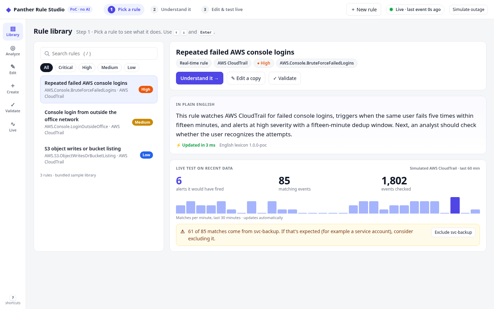

*Figure 1. Step 1 · Rule library: search, severity filters and instant selection. The right side shows the rule in plain English plus live results, including a false-positive hint with a one-click Exclude.*

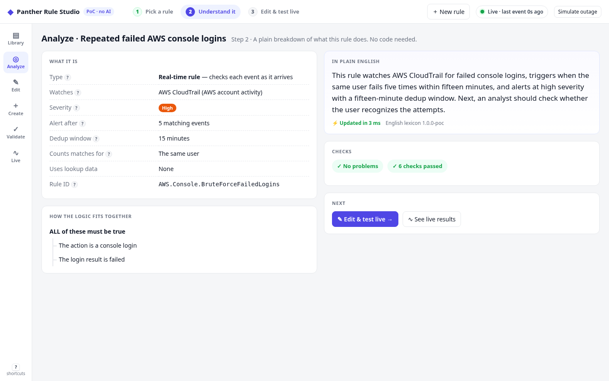

*Figure 2. Step 2 · Analyze: the structured breakdown (type, source, severity, threshold, dedup, grouping), the logic tree in plain words, the English explanation, and the check summary.*

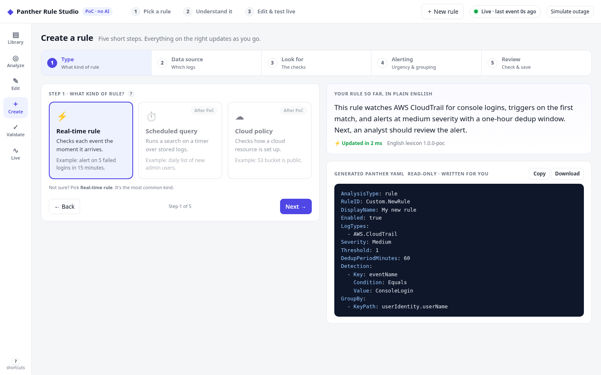

*Figure 3. Create wizard, step 1 · Pick the rule type. Real-time rule is the default; scheduled queries and policies are marked as after the PoC.*

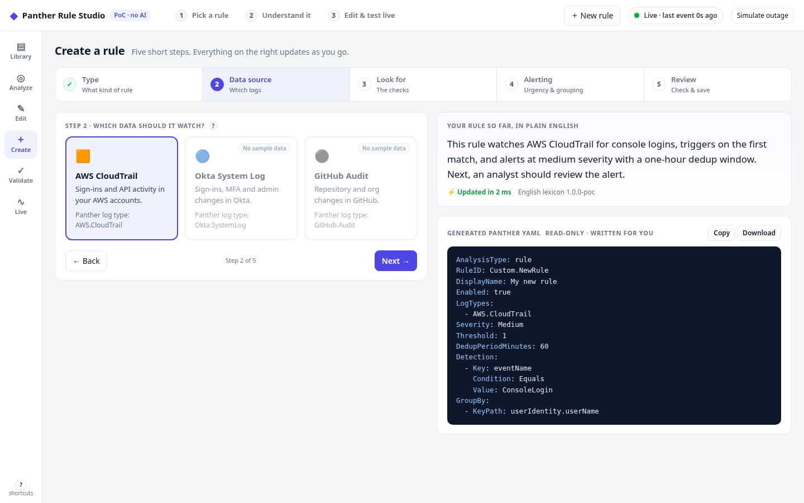

*Figure 4. Create wizard, step 2 · Pick the data source, with the Panther log type shown under each card.*

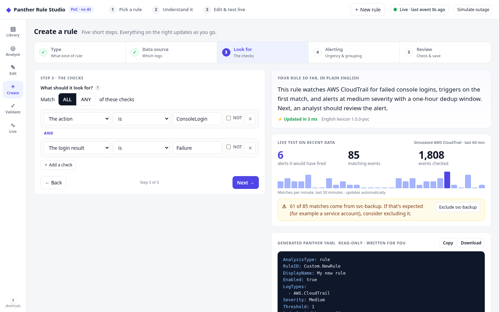

*Figure 5. Create wizard, step 3 · Build the checks with dropdowns (ALL/ANY, field, operator, value, NOT). English, YAML and the live test update as you type.*

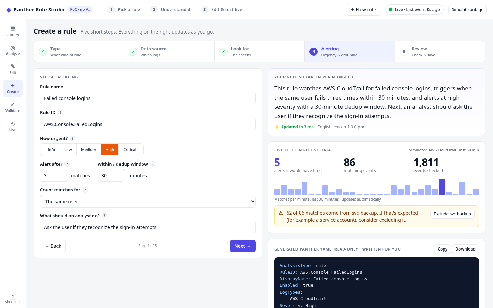

*Figure 6. Create wizard, step 4 · Alerting: name, rule ID, severity, threshold, dedup window, grouping and runbook, each with a tooltip.*

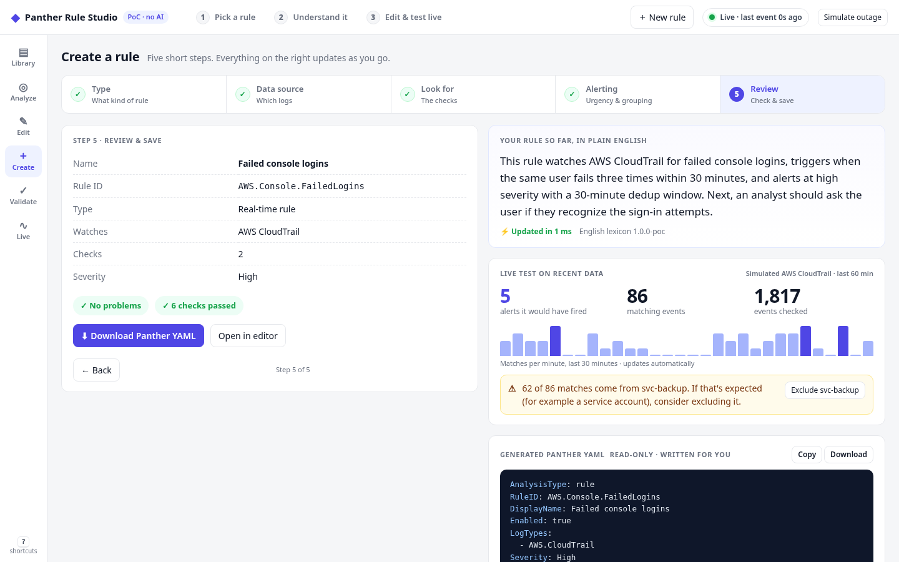

*Figure 7. Create wizard, step 5 · Review and save: summary, validation result, live test and the Panther YAML download.*

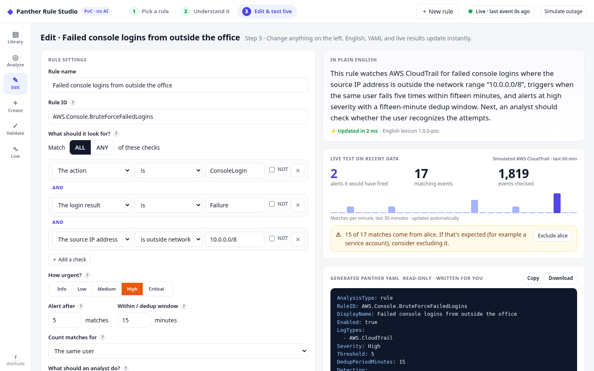

*Figure 8. Editing a rule: adding an 'outside the office network' check instantly rewrites the English, regenerates the YAML (updated in 2 ms) and re-runs the live test (2 alerts from 17 matches).*

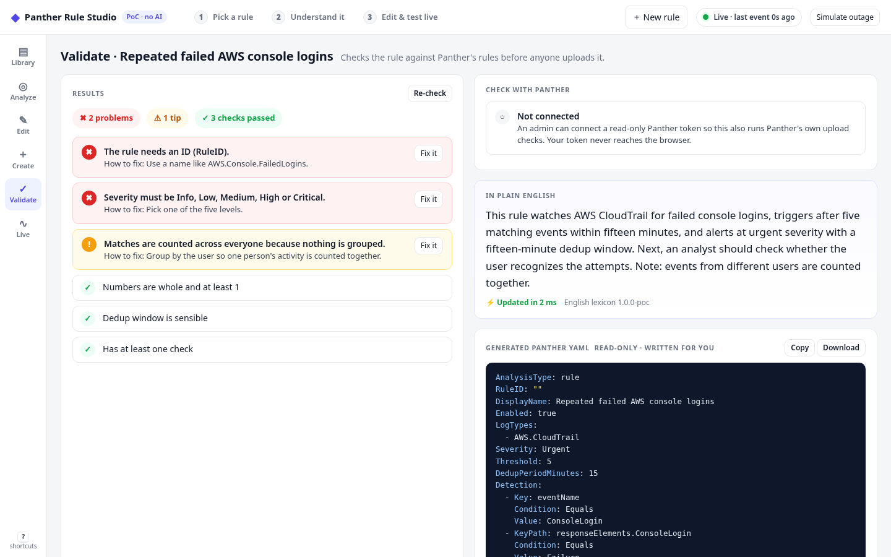

*Figure 9. Validation with errors: a missing rule ID and an invalid severity (errors) plus ungrouped counting (tip), each with a plain fix and a Fix it button; passed checks are listed below.*

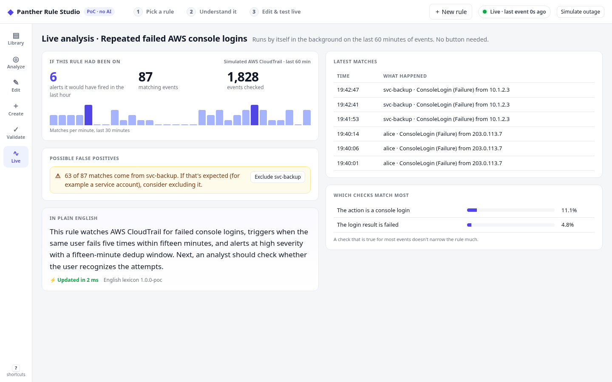

*Figure 10. Live background analysis: 'would have fired 6 alerts in the last hour' with no Run button, the per-minute chart, the latest matches, how often each check matches, and a false-positive hint (most matches come from svc-backup).*

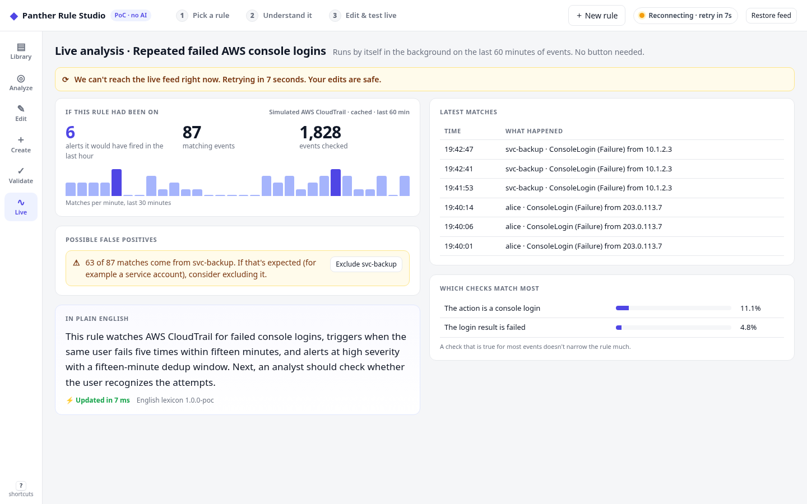

*Figure 11. Degraded feed: the amber status pill and banner count down to the next retry; results keep showing cached data and edits stay instant.*

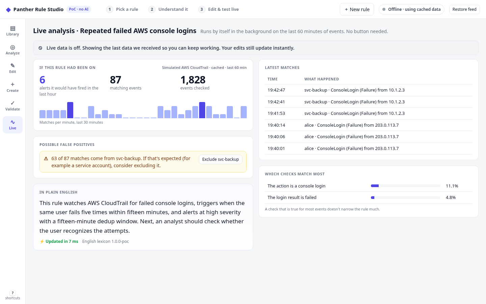

*Figure 12. Offline feed: after the retries run out, a grey status and a plain message explain that cached data is being shown.*

The ASCII wireframes below are the design references the screenshots were built from.

### 21.1 Design language

- One-page app with a left nav: **Library · Analyze · Create · Validate · Glossary**.
- Calm, modern look: neutral background, one accent color, 8-px spacing grid, system fonts, light/dark mode.
- Severity colors: Info grey, Low blue, Medium yellow, High orange, Critical red — always with a text label (accessible, not color-only).
- **Tooltips everywhere**: every Panther term has a dotted underline; hover or tap shows a one-sentence definition with a "Learn more" link to the Glossary.
- Keyboard-friendly: `/` focuses search, `↑/↓` moves through the library, `Enter` opens.
- Accessibility: WCAG 2.1 AA contrast, ARIA live region announces "Rule would fire 3 times in the last hour" for screen readers.

### 21.2 Screen 1 — Rule Library (selection, PoC P1)

```
┌──────────────────────────────────────────────────────────────────────────────────────────┐
│ ◆ Panther Rule Studio                                  ● Live · 4 s ago   Tim ▾          │
├────────────┬─────────────────────────────────┬───────────────────────────────────────────┤
│ Library  ◀ │ 🔍 Search rules…            [/] │  Repeated failed AWS console logins       │
│ Analyze    │ Type ▾  Log source ▾  Sev ▾     │  [Rule ⓘ] [AWS CloudTrail] [High]         │
│ Create     │─────────────────────────────────│───────────────────────────────────────────│
│ Validate   │ ▶ AWS Console Login Failures  H │  IN PLAIN ENGLISH                         │
│ Glossary   │   AWS Root Activity           C │  This rule watches AWS CloudTrail for     │
│            │   Okta MFA Reset              M │  failed console logins, triggers when the │
│            │   GitHub Repo Made Public     H │  same user fails five times within        │
│            │   S3 Bucket Public (policy)   H │  fifteen minutes, and alerts at high      │
│            │   Daily Admin Logins (query)  L │  severity with a fifteen-minute dedup     │
│            │   …                             │  window.                                  │
│            │                                 │───────────────────────────────────────────│
│            │ 214 rules · 3 log sources       │  LIVE (last 60 min)       ▁▂▁▅▇▂▁ /min   │
│            │                                 │  Would have fired 3 alerts (11 matches)   │
│            │                                 │  ⚠ Most matches come from one user        │
│            │                                 │───────────────────────────────────────────│
│            │                                 │  [Open in Analyze]  [Edit a copy]         │
└────────────┴─────────────────────────────────┴───────────────────────────────────────────┘
```

Selecting a row is instant: the catalog is loaded once, the detail pane is fetched (`GET /api/rules/{id}` returns IR + English + findings, cached), and live analysis starts automatically for that rule.

### 21.3 Screen 2 — Analyze (structured breakdown)

```
┌──────────────────────────────────────────────────────────────────────────────────────────┐
│ Analyze   [Paste a rule ▾] [Upload file]                     Detected: Panther YAML + Py │
├───────────────────────────────────────────┬──────────────────────────────────────────────┤
│ WHAT IT IS                                │ IN PLAIN ENGLISH                             │
│  Type ............ Real-time rule ⓘ       │ This rule watches AWS CloudTrail for failed  │
│  Watches ......... AWS CloudTrail ⓘ       │ console logins, triggers when the same user  │
│  Severity ........ High                   │ fails five times within fifteen minutes, and │
│  Threshold ⓘ ..... 5 matching events      │ alerts at high severity with a fifteen-      │
│  Dedup window ⓘ .. 15 minutes             │ minute dedup window. Next, an analyst should │
│  Grouped by ...... the user               │ check whether the user recognizes the        │
│  Uses lookup data  none                   │ attempts.                                    │
│  Helpers ......... none                   │                                              │
│  Tests ........... 2 (1 alert, 1 no-alert)│ ⓘ Explanation lexicon 1.3.0                  │
├───────────────────────────────────────────┤──────────────────────────────────────────────┤
│ HOW THE LOGIC FITS TOGETHER               │ CHECKS                                       │
│  ALL of these must be true                │  ✓ Required fields present                   │
│   ├─ the event is a console login         │  ✓ Severity is valid                         │
│   └─ the login result is failed           │  ⚠ Only 15 min dedup; fine for brute force   │
│                                           │  ✓ Has a should-not-alert test               │
│  [Show source ▸]  (collapsed by default)  │                                              │
└───────────────────────────────────────────┴──────────────────────────────────────────────┘
```

The logic tree view uses plain-English leaf labels; the original source is available behind a collapsed "Show source" toggle for experienced users.

### 21.4 Screen 3 — Create / Edit wizard (form-only, live outputs, PoC P2)

```
┌──────────────────────────────────────────────────────────────────────────────────────────┐
│ Edit: AWS.Console.BruteForceFailedLogins (copy)     ① Type ② Source ③ Logic ④ Alerting  │
├─────────────────────────────────────────┬────────────────────────────────────────────────┤
│ ③ WHAT SHOULD IT LOOK FOR?              │ IN PLAIN ENGLISH                 (updates live)│
│                                         │ This rule watches AWS CloudTrail for failed    │
│ Match [ALL ▾] of these:                 │ console logins from outside the office         │
│  ┌──────────────┬────────┬───────────┐  │ network, triggers when the same user fails     │
│  │ Event name ⓘ │ is     │ConsoleLogin│ ✕│ five times within fifteen minutes, and alerts  │
│  │ Login result │ is     │ Failure ▾  │ ✕│ at high severity with a fifteen-minute dedup   │
│  │ Source IP    │not in  │10.0.0.0/8  │ ✕│ window.                                       │
│  └──────────────┴────────┴───────────┘  │────────────────────────────────────────────────│
│  [+ Add check]  [+ Add group (ANY/NONE)]│ LIVE ANALYSIS  ● Live · Sample data            │
│                                         │ Would have fired 2 alerts in the last hour     │
│ ④ ALERTING                              │ 7 matching events · ▁▁▂▆▂▁                     │
│  Severity  ( )Info ( )Low ( )Med (•)High│ ✓ Removing office IPs cut matches by 36%       │
│  Alert after [5] matches ⓘ              │ ⚠ 80% of matches from one user (svc-backup)    │
│  …within / dedup window [15 min ▾] ⓘ    │  [Exclude this user]                           │
│  Group by  [the user ▾] ⓘ               │────────────────────────────────────────────────│
│  Runbook   [Check with the user…      ] │ GENERATED PANTHER YAML (read-only) [Copy] [⬇]  │
│                                         │  AnalysisType: rule                            │
│ ✓ No errors · 1 tip                     │  RuleID: AWS.Console.BruteForceFailedLogins    │
│ [◀ Back]                    [Next ▶]    │  Severity: High ...                            │
└─────────────────────────────────────────┴────────────────────────────────────────────────┘
```

- **No raw YAML editing**: the YAML pane is read-only output for copying or download.
- Field dropdowns are populated from the selected log type's schema (bundled; or from Panther's `dataLakeDatabase` columns when connected), each with a friendly name and tooltip.
- Operator dropdowns show plain words ("is", "is not", "contains", "is one of", "is in network range").
- Every change → fast lane (English + YAML + checks in < 200 ms) and live lane (counts update within ~1 s).
- One-click fixes from FP indicators ("Exclude this user") add a NOT condition to the form, and the English updates to say so.

### 21.5 Screen 4 — Validate results

```
┌──────────────────────────────────────────────────────────────────────────────────────────┐
│ Validate   AWS.Console.BruteForceFailedLogins          [Re-check]  [Check with Panther]  │
├──────────────────────────────────────────────────────────────────────────────────────────┤
│ ✖ 1 problem   ⚠ 2 tips   ✓ 14 checks passed                                              │
│                                                                                          │
│ ✖ Severity "Urgent" isn't a Panther severity.                                            │
│   How to fix: pick Info, Low, Medium, High or Critical.            [Set to High]         │
│ ⚠ Alerts are counted across all users because no "group by" is set.                      │
│   How to fix: group by the user so one person's failures are counted together. [Fix]   │
│ ⚠ No "should not alert" test.                                    [Add from live data]   │
│                                                                                          │
│ Panther check: ○ Not run (needs a Panther connection set up by an admin)                 │
└──────────────────────────────────────────────────────────────────────────────────────────┘
```

### 21.6 Screen 5 — Live Analysis panel (expanded, PoC P3)

```
┌──────────────────────────────── LIVE ANALYSIS ───────────────────────────────────────────┐
│ ● Live · last event 4 s ago · source: Simulated CloudTrail · window: last 60 min         │
│                                                                                          │
│  Would have fired  3 alerts        Matching events  11        Events checked  4,812      │
│  ▁▁▂▁▁▅▇▂▁▁▁▂▁  matches per minute                                                       │
│                                                                                          │
│  POSSIBLE FALSE POSITIVES                                                                │
│   ⚠ 8 of 11 matches are from svc-backup. Is that a known service account? [Exclude]     │
│                                                                                          │
│  LATEST MATCHES                                                                          │
│   12:41  alice failed a console login from 203.0.113.7         ✓ event  ✓ failed         │
│   12:41  alice failed a console login from 203.0.113.7         → part of alert #3        │
│   12:39  svc-backup failed a console login from 198.51.100.4                             │
│                                                                                          │
│  WHICH CHECKS MATCH MOST                                                                 │
│   the event is a console login ........ 2.1% of events                                   │
│   the login result is failed .......... 0.3% of events                                   │
└──────────────────────────────────────────────────────────────────────────────────────────┘
Degraded example:  ● (amber) "We can't reach Panther right now. Retrying in 20 seconds. Your edits are safe."
Offline example:   ● (grey)  "Live data is off. Showing saved sample data so you can keep working."
```

### 21.7 User flows

```
Beginner, existing rule:   Library → select → read English + live counts → Analyze → (Edit a copy)
Beginner, new rule:        Create → ① type → ② log source → ③ checks → ④ alerting
                           (English, YAML and live counts update on every change) → Validate → Download
Reviewer:                  Analyze → paste rule → breakdown + checks → Check with Panther → export report
```

### 21.8 Glossary and tooltips

- Glossary content is the table in §2, stored as `glossary.v1.yaml` and versioned with the lexicon.
- Tooltips use a single small component (`<abbr data-term="dedup">`) that looks up the glossary; no external tooltip library.

---

## 22. Performance

"Easy to use, very fast" is a requirement, so the PoC is built and measured against explicit budgets.

### 22.1 Targets

| Metric | Target | PoC measurement (localhost, headless Chrome) |
|---|---|---|
| First paint / app ready | < 1 s | App ready in 36–131 ms across all 12 screens |
| Rule selection (click → English + YAML on screen) | < 50 ms | Effectively instant: English and YAML are prefetched for every library rule at startup and served from memory |
| Edit → plain English + YAML + checks updated | < 50 ms | 1–15 ms round trip, shown on screen as "⚡ Updated in N ms" |
| Edit → live analysis pushed to the browser | < 1 s | 0.3–1.3 s: a 300 ms debounce plus one analysis tick of up to 1 s over about 1,800 events. Meeting the target needs a shorter tick or analysis triggered by each edit (see 22.2). |
| New events → live numbers refreshed | ≤ 1 s | Re-evaluated every 1 s and pushed over SSE |
| Main-thread work per keystroke | < 4 ms | Only field updates plus one requestAnimationFrame paint |
| JavaScript and CSS shipped | < 100 KB, no CDN | About 50 KB total (app.js + styles.css + index.html), no framework, no external requests |

### 22.2 How the design meets them

- **No framework, no build, no CDN.** Three small static files served by the app itself. Nothing is fetched from third parties, which also satisfies the strict CSP (`script-src 'self'`).
- **Non-blocking script.** `app.js` is an ES module (deferred by default), so HTML and CSS paint before the script runs.
- **Prefetch for instant selection.** One `GET /api/rules` loads the whole library. Previews (English, YAML, findings) for every rule are fetched in parallel at startup and cached, so clicking a rule or pressing ↑/↓ never waits on the network.
- **Fast lane, not debounced.** Previews are cheap pure functions (sub-millisecond on the server), so every edit fires immediately. Requests are coalesced: one in flight at a time, the latest revision wins, and stale responses are dropped by revision number.
- **Live lane, debounced.** Draft updates for background analysis are debounced 300 ms. Analysis runs on a server thread (an asyncio task or process pool in production, §15.3) and results are pushed over SSE, so the browser never polls or blocks.
- **Hitting the < 1 s push target.** In the PoC, pushes can take up to about 1.3 s, because a draft waits for the next 1-second analysis tick after the 300 ms debounce. Production closes that gap by starting analysis as soon as an edit arrives (the latest-wins mailbox in §15.3) and keeping the tick only for new events.
- **Batched rendering.** All DOM updates go through a single `requestAnimationFrame` paint that sets only the panels that changed (English, YAML, findings, live numbers). The form itself is re-rendered only on structural changes (adding or removing a check), so typing never loses focus or janks.
- **Keyboard-first.** `/` search, `↑ ↓` or `J K` to move, `Enter` to open, `L A E V G` to switch views, `N` for a new rule, `?` for help, `Esc` to close or leave a field.
- **Small payloads.** SSE messages carry only display fields (counts, a 30-point sparkline, 6 latest matches), typically under 2 KB.
- **Budgets enforced in CI** (production): a Playwright check that fails the build if app-ready exceeds 1 s or the "Updated in" value exceeds 50 ms on the reference machine.

## 23. Module and Directory Layout

```
panther-rule-studio/
├── prs_core/                    # pure library, no I/O
│   ├── ir.py                    # pydantic IR models (§7)
│   ├── ingest.py                # format detection
│   ├── parse/
│   │   ├── yaml_spec.py
│   │   ├── simple_ops.py        # Simple Detection condition ↔ IR op map
│   │   ├── python_body.py       # ast visitor
│   │   └── sql_query.py         # sqlglot
│   ├── normalize.py
│   ├── validate/
│   │   ├── checks.py            # V001–V017
│   │   └── findings.py
│   ├── generate/
│   │   ├── simple_yaml.py
│   │   ├── python_rule.py
│   │   └── scheduled.py
│   ├── render/                  # renderer module (isolated, F7)
│   │   ├── tree.py              # logic tree build + normalization (De Morgan)
│   │   ├── compose.py           # walk + joins + Oxford comma
│   │   ├── numbers.py           # number/duration words
│   │   └── lexicon/             # versioned data (§12)
│   │       ├── lexicon.v1.3.0.yaml
│   │       ├── fields/*.yaml
│   │       ├── glossary.v1.yaml
│   │       └── CHANGELOG.md
│   └── evaluate/
│       ├── interpreter.py       # safe IR evaluator (3-valued)
│       ├── alerts.py            # threshold + dedup simulation
│       └── fp_indicators.py
├── prs_app/                     # FastAPI application
│   ├── main.py                  # routes, SSE, static
│   ├── auth.py                  # OIDC/session/CSRF
│   ├── live/
│   │   ├── orchestrator.py      # per-session latest-wins tasks
│   │   └── window.py            # ring buffers
│   ├── sources/
│   │   ├── base.py              # DataSource protocol
│   │   ├── simulated.py
│   │   ├── replay.py
│   │   ├── panther_datalake.py
│   │   ├── panther_alerts.py
│   │   └── webhook.py
│   ├── panther/client.py        # the only module with the token
│   ├── library.py
│   └── logging_redact.py
├── web/                         # static frontend, no build
│   ├── index.html
│   ├── app.js  state.js  api.js  components/*.js
│   └── styles.css
├── tests/
│   ├── unit/  property/  contract/  e2e/
│   ├── golden/v1/*.txt          # renderer goldens, per lexicon MAJOR
│   └── fixtures/                # panther-analysis samples, synthetic events
├── schemas/ir.v1.json
├── deploy/ Dockerfile  compose.yaml  k8s/
└── pyproject.toml
```

---

## 24. Error Handling

| Category | Example | API response | UI message |
|---|---|---|---|
| Input format | Not YAML/Python/SQL | 422 `UNRECOGNIZED_FORMAT` | "This doesn't look like a Panther rule…" + examples |
| Syntax | Bad indentation at line 12 | 422 `SYNTAX_ERROR` + span | Highlights the line in "Show source"; plain explanation |
| Partial understanding | Helper call in Python | 200 + `Opaque` nodes + caveat | "Part of this rule uses custom code this tool can't explain yet." |
| Validation | Missing `RuleID` | 200 + findings | Problem list with fix buttons |
| Limits | 2 MB upload | 413 | "That file is too big. Rules are usually a few KB." |
| Live feed | Panther timeout | SSE `feed_status` | See §17 |
| Internal | Bug | 500 + correlation id | "Something went wrong on our side. Reference: 7f3a…" |

All errors use one JSON envelope: `{"error": {"code", "message", "hint", "span", "correlation_id"}}`. Messages avoid jargon; technical detail is behind "Details". Exceptions never leak stack traces to the client.

---

## 25. Deployment Options

| Option | Best for | Notes |
|---|---|---|
| **Local laptop** (`uvicorn` or `python poc/server.py`) | PoC demos, individual analysts | Simulated data by default; binds to 127.0.0.1 |
| **Single container** (Docker/Podman) | Team pilot | Non-root user, read-only root FS, secrets injected at runtime, one replica |
| **Internal VM / ECS / Cloud Run behind SSO proxy** | Small team production | oauth2-proxy or ALB OIDC in front; egress allow-list to Panther |
| **Kubernetes** | Larger orgs | Collector deployment (1 replica) + stateless API (N replicas) + Redis Streams/Postgres; External Secrets Operator for tokens; NetworkPolicy egress to Panther only |

The container image contains no secrets and no data; configuration is via environment variables (`PRS_DATA_SOURCE`, `PANTHER_API_HOST`, `PRS_WINDOW_MINUTES`, …).

---

## 26. PoC Scope and Milestones

### 26.1 PoC scope

**In scope**

- Rule library from a local folder (bundled samples, optionally `panther-analysis`), with instant selection and detail.
- Form-only editor for real-time rules (Simple Detection subset: ALL/ANY/NOT groups; equals, not equals, contains, starts with, one of, in network range).
- Live plain English and generated YAML on every edit (fast lane).
- Background live analysis over a **simulated CloudTrail/Okta stream** with injected attack bursts, pushed over **SSE**: fired count, matches, sparkline, top FP indicators.
- Feed health indicator and degraded/offline/sample behavior (with a "simulate outage" toggle for demos).
- Static validation (V001–V007, V012).

**Out of scope for the PoC**

- SSO (PoC binds to localhost), Panther live connection (designed, adapter stubbed), Python/SQL editing (Analyze-only for those), policies' live evaluation, PAT integration.

### 26.2 Milestones

| # | Milestone | Deliverable | Exit criteria |
|---|---|---|---|
| M0 | Skeleton | Server, static UI, SSE heartbeat, simulated stream | Browser shows "Live · n s ago" |
| M1 | Core IR + renderer | IR, Simple Detection parser, renderer + lexicon v1, goldens | Exhaustive Boolean suite green; no code leakage |
| M2 | Rule selection | Library, detail pane, instant select | Select → English in < 200 ms |
| M3 | Form editor | Wizard, live English + YAML, static validation | Every form change updates both panes; YAML passes `pat test` |
| M4 | Live analysis | Window buffer, evaluator, threshold/dedup sim, SSE results, FP indicators | "Would have fired N" updates within 1 s of an edit and as events arrive |
| M5 | Degradation | Health states, backoff, fallback to cache/sample, outage toggle | Kill the feed → UI shows Degraded → Offline/Sample; edits keep working |
| M6 | Panther adapter (pilot) | `PantherDataLakeSource` with polling, read-only token, redaction | Real data in a non-prod Panther; token never visible client-side |
| M7 | Hardening | SSO proxy, CSP, rate limits, audit log, container | Security review sign-off |

### 26.3 PoC-to-production transition

1. **Same interfaces**: the UI and orchestrator only know `DataSource` and SSE events, so switching data is configuration: `PRS_DATA_SOURCE=simulated` → `replay` → `panther`.
2. **Replay first**: export a sanitized hour of real CloudTrail from Panther (data lake query) to JSONL and run it through `ReplaySource` to validate field mappings against real shapes.
3. **Read-only Panther**: create the least-privilege read token (§20.2), IP-restricted, with expiry, stored in the secrets manager; enable `PantherDataLakeSource` in a non-prod instance; tune poll interval and `LIMIT` against data lake cost.
4. **Parity check**: for existing rules, compare PRS's predicted alerts with Panther's actual alerts (via `PantherAlertsSource`) over the same window; investigate gaps (usually opaque Python logic or late-arriving data).
5. **Production**: add SSO, move ingest to a single collector if running multiple replicas, keep "Sample data" as the automatic fallback.

### 26.4 PoC skeleton

A minimal, runnable skeleton is provided in `/workspace/panther-tool/poc` (Python standard library only, no installs):

- `server.py`: stdlib HTTP server with SSE, simulated CloudTrail stream, sliding window, safe evaluator, threshold/dedup simulation, FP indicator, renderer and YAML generator.
- `index.html`, `app.js`, `styles.css`: the single-page UI, with no framework and no CDN. It covers the library, Analyze, a five-step Create wizard, the form editor with live English and YAML, Validate with one-click fixes, the Live analysis view, keyboard shortcuts, and feed status with an outage toggle.
- Run: `python3 server.py` then open `http://127.0.0.1:8765`.

It demonstrates P1–P3 end to end; it is intentionally small and is not production code (no auth, in-memory only, simplified renderer).

---

## 27. v2 Roadmap (Where AI Could Go)

| Item | Description | Guardrails |
|---|---|---|
| Optional AI explanation assist | LLM rephrases the deterministic English for tone, never replaces it; side-by-side "deterministic vs. assisted" | Off by default; deterministic text remains the source of truth; no rule content leaves the tenant without admin approval |
| AI-suggested tuning | Suggest exclusions based on FP indicators | Suggestions only; analyst applies via the form; every suggestion explained |
| Natural-language rule drafting | "Alert when someone disables MFA in Okta" → draft form values | Output lands in the form for review; validation and live analysis still required |
| Python/SQL editing in forms | Round-trip more Python patterns and SQL into the form | Expanded AST mapping + goldens |
| Correlation rules | Support `correlation_rule` analysis and English | New lexicon frames (MAJOR bump) |
| Collaborative editing | Shared drafts, comments | Would justify WebSockets (§16) |
| Detection coverage map | MITRE ATT&CK view from `Reports` | Read-only |
| Git integration | Open a PR to the detections repo with generated files | Uses the team's git workflow; no direct Panther upload |
| Sandboxed Python evaluation | Run real `rule()` in a gVisor/Firecracker sandbox for exact live results | Admin opt-in, no network, strict limits |

---

## 28. Appendices

### 28.1 Example: Python rule → IR → English

```python
# aws_console_login_failed.py
def rule(event):
    return (event.get("eventName") == "ConsoleLogin"
            and event.deep_get("responseElements", "ConsoleLogin") == "Failure")

def title(event):
    return f"Failed console login for {event.deep_get('userIdentity', 'arn')}"

def dedup(event):
    return event.deep_get("userIdentity", "arn")
```

IR (abridged):

```json
{"kind":"rule","authoring":"python","id":"AWS.Console.LoginFailed","log_types":["AWS.CloudTrail"],
 "severity":"High","threshold":5,"dedup":{"period_minutes":15,"keys":[{"path":["userIdentity","arn"]}]},
 "logic":{"kind":"group","op":"all","children":[
   {"kind":"condition","field":{"path":["eventName"]},"op":"equals","value":"ConsoleLogin"},
   {"kind":"condition","field":{"path":["responseElements","ConsoleLogin"]},"op":"equals","value":"Failure"}]},
 "alert_title":"dynamic"}
```

English:

> This rule watches AWS CloudTrail for failed console logins, triggers when the same user fails five times within fifteen minutes, and alerts at high severity with a fifteen-minute dedup window.

### 28.2 Example: data lake polling (GraphQL)

```graphql
mutation Run { executeDataLakeQuery(input: { sql: "SELECT * FROM panther_logs.public.aws_cloudtrail WHERE p_event_time > '2026-11-20 18:00:00' ORDER BY p_event_time LIMIT 5000" }) { id } }

query Poll { dataLakeQuery(id: "<id>") { status message results { edges { node } pageInfo { hasNextPage endCursor } } } }
```

Sent as `POST https://api.<instance>.runpanther.net/public/graphql` with headers `X-API-Key: <token>` and `Content-Type: application/json`.

### 28.3 References (verified November 20, 2026)

- Panther API overview, tokens, IP restrictions and rotation: <https://docs.panther.com/panther-developer-workflows/api>
- Data lake queries (GraphQL, async execute + poll): <https://docs.panther.com/panther-developer-workflows/api/graphql/data-lake-queries>
- REST Rules API (`GET /rules`, `run-tests-only`, permissions): <https://docs.panther.com/panther-developer-workflows/api/rest/rules>
- Permission names (Console ↔ API): <https://docs.panther.com/system-configuration/rbac>
- Simple Detections YAML and match expressions: <https://docs.panther.com/detections/rules/writing-simple-detections>
- PAT commands and per-command permissions (`validate` → BulkUpload or BulkUploadValidate): <https://docs.panther.com/panther-developer-workflows/detections-repo/pat/pat-commands>
- Panther-managed detections (sample library): <https://github.com/panther-labs/panther-analysis>

> **Verify before build:** exact REST paths for alerts, the full list of Simple Detection `Condition` names, and the log-type table map should be re-checked against the Panther version in use, since Panther updates its APIs regularly.
